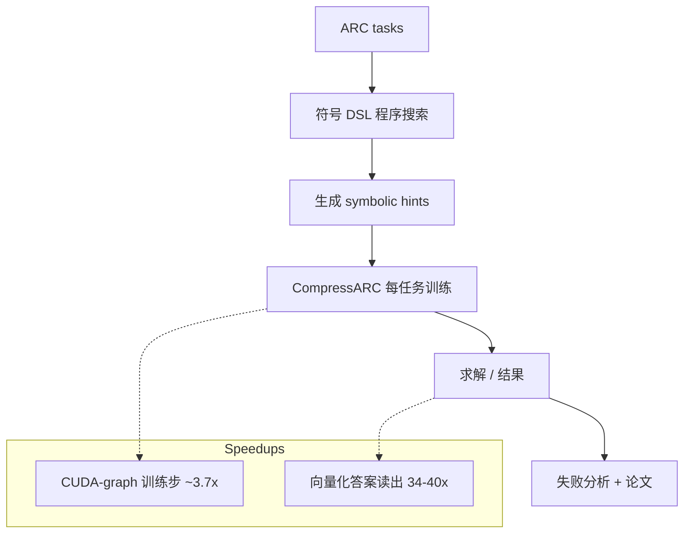

# Symbolic hints for CompressARC（ARC Prize 2026）

面向 **ARC Prize 2026 Paper Track（ARC-AGI-2）** 的代码、原始结果与论文草稿。研究问题：能否用**廉价的符号程序搜索**为 CompressARC（无预训练、按任务训练小网络）提供有用的先验知识？三个受控实验的结论：在我们尝试的形式下**没有显著帮助**；同时给出两种**保持求解率不变**的加速。

## 主要内容
- `arcsolver/`：符号 DSL 求解与“提示注入”CompressARC
- 三个受控实验：① 最优部分正确 DSL 程序输出作为门控 logit 偏置；② 输出尺寸先验；③ 失败分析
- 两个加速：**CUDA-graph 训练步**（Kaggle T4 上约 **3.7×**）；**向量化答案读出**（读出本身 **34–40×**）
- `paper/` 论文草稿 · `results/` 原始结果 · `scripts/` 复现脚本 · `tests/` 测试 · `WORKLOG.md` 研究记录

## 架构与流程


## 项目结构
```
arc-prize-2026/
├─ arcsolver/    # 符号求解与提示注入
├─ paper/        # 论文草稿
├─ results/      # 原始结果
├─ scripts/      # 复现脚本
├─ tests/
├─ WORKLOG.md
└─ README.md / README_EN.md
```

## 快速开始
```
git clone https://github.com/Ethan-upgrade/arc-prize-2026.git
cd arc-prize-2026
# 依赖基于上游 CompressARC（见 scripts/ 与 requirements）
python -m pip install -r requirements.txt   # 如存在
# 运行复现实验见 scripts/ 与 WORKLOG.md
```

> 本仓库派生自 / 基于 [iliao2345/CompressARC](https://github.com/iliao2345/CompressARC)，保留其许可与声明。

## 许可证
见 `LICENSE`。