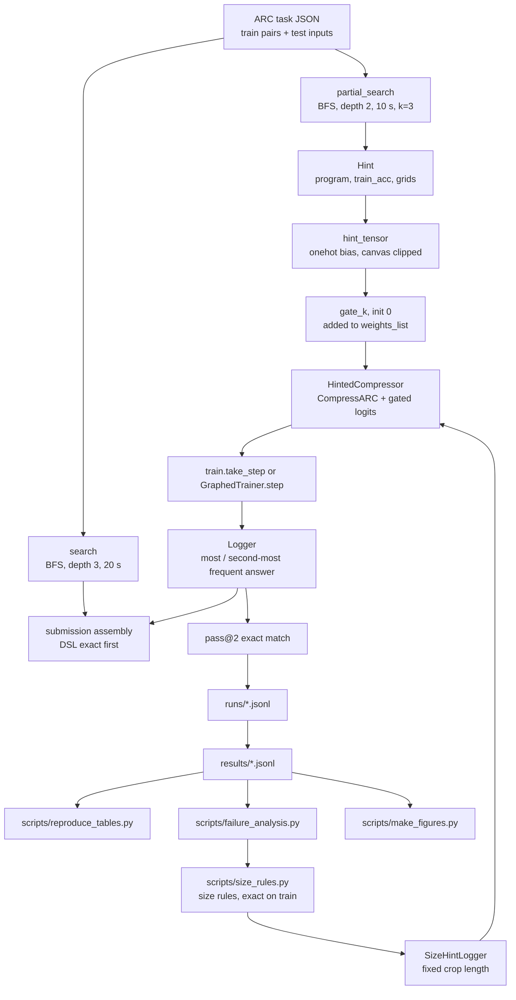
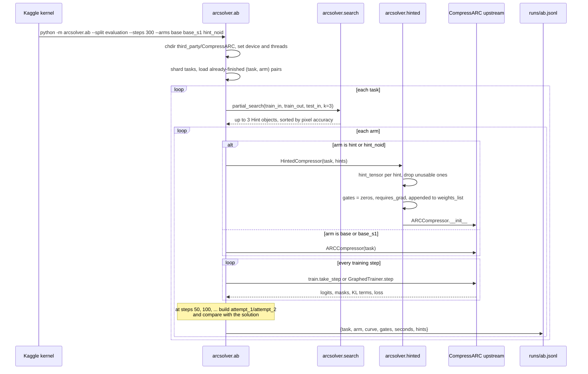
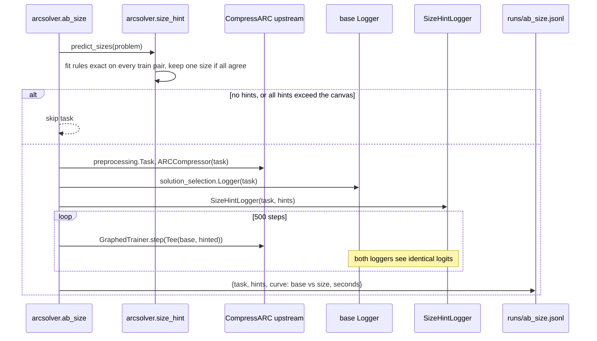
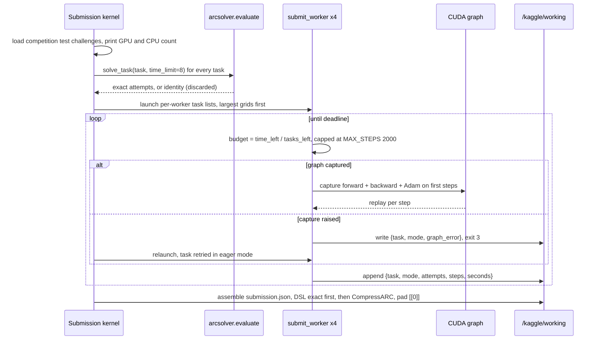
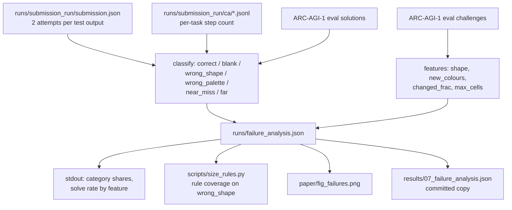
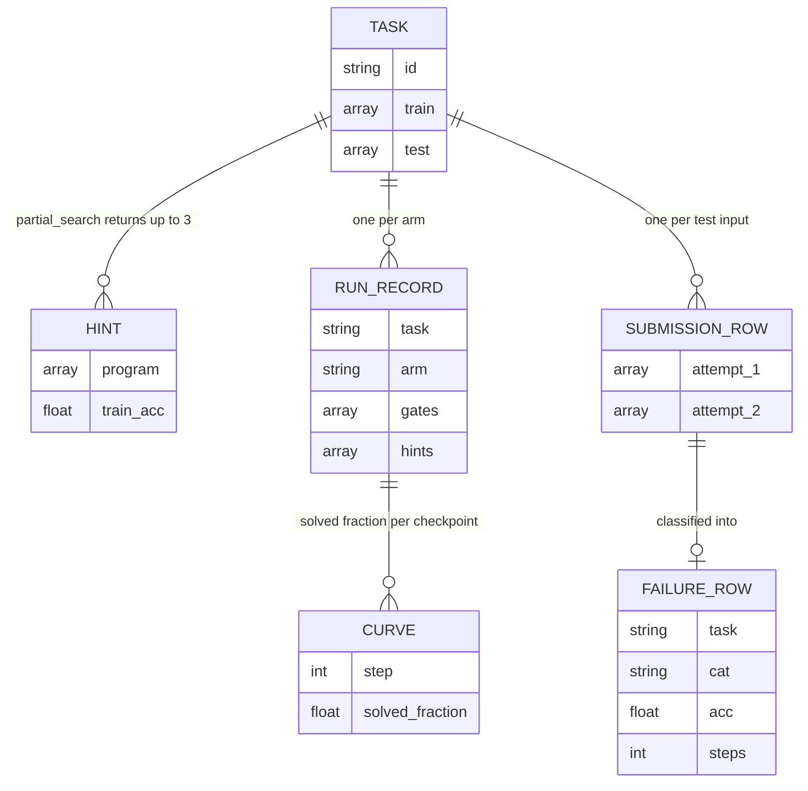
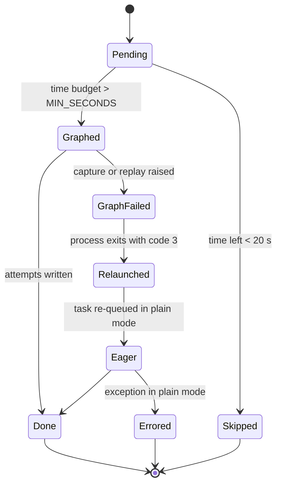

# Symbolic hints for CompressARC — ARC Prize 2026

[English](README.md) | [简体中文](README.zh-CN.md)

Research code, raw run logs and a paper draft for an ARC Prize 2026 Paper Track entry on
ARC-AGI-2. The question: can cheap symbolic program search give CompressARC — a small network
trained from scratch on every task, with no pretraining — useful prior knowledge? The answer,
in the forms tested here, is no measurable gain. A whole-answer hint channel was used by the
model but did not solve more tasks than changing the random seed; a size-only hint was exactly
right on every task it fired on and still solved none. Along the way the repository also
contains two solve-rate-preserving speedups (a CUDA-graph training step and a vectorised answer
read-out) and everything needed to recompute the paper's tables from `results/`.

This is a research artifact, not a library. Nothing here is packaged, versioned or released.

---

## Overview

ARC-AGI-2 is a set of grid puzzles where a solver sees a few input/output examples and must
produce the output for a new input. CompressARC (Liao & Gu, 2025) attacks it with minimum
description length: for each task it trains a tiny decoder from scratch until the shortest
program that explains the training pairs is found. It is strong on ARC-AGI-1 (~20% on the
evaluation split) and weak on ARC-AGI-2 (~4%).

The idea explored here is a division of labour. A symbolic DSL searches for a *partially*
correct program — ≥50% of cells right on the training pairs — and its output is offered to
CompressARC as an additive bias on the output logits, behind a learnable gate initialised at
zero. If the hint helps, the gate grows; if not, it stays near zero. Three controlled studies
follow from that: the whole-answer hint A/B (two rounds), a failure analysis of where
CompressARC actually errs, and a size-only hint built from that analysis, which changes only
how an answer is decoded.

The intended reader is someone reproducing the numbers, extending the hint channel, or reusing
the CUDA-graph trainer for another per-task-training model. `WORKLOG.md` is the chronological
lab notebook; `paper/` holds the draft; `results/` holds every log the paper cites.

Two caveats stated up front:

- **The repo does not vendor its dependencies.** `third_party/CompressARC` (upstream solver and
  datasets) and `data_repo/` (ARC-AGI-2 data) are listed in `.gitignore`. Almost every module
  imports `arc_compressor`, `train`, `layers` or `solution_selection` from that directory, so a
  fresh clone cannot run anything until you clone CompressARC into `third_party/`.
- **The hint channel is not part of any submitted solution.** The submission worker trains a
  plain `ARCCompressor`; submissions combine exact DSL answers with unmodified CompressARC
  (`arcsolver/submit_worker.py:38`). Hints are an experiment, not a component of the entry.

---

## Table of Contents

- [Research question](#research-question)
- [Features](#features)
- [Architecture](#architecture)
- [Key flows](#key-flows)
- [Data model](#data-model)
- [Experiments and results](#experiments-and-results)
- [Speedups](#speedups)
- [Directory layout](#directory-layout)
- [Getting started](#getting-started)
- [Commands](#commands)
- [Configuration](#configuration)
- [Kaggle packaging](#kaggle-packaging)
- [Troubleshooting](#troubleshooting)
- [Design decisions & limitations](#design-decisions--limitations)
- [FAQ](#faq)
- [License](#license)

---

## Research question

CompressARC's inductive bias already contains most of what a hand-written DSL can express:
rotation/reflection equivariance, per-colour channels, propagation layers. A DSL hint therefore
only helps in proportion to how much information it carries that the learner's prior lacks
(`paper/draft.md` §5). The repository tests that prediction in three steps:

1. **Whole-answer hints** — does a partially correct program output, injected as a gated logit
   bias, solve more tasks or solve them earlier? (Two rounds on ARC-AGI-1 evaluation tasks.)
2. **Failure analysis** — where does the unmodified solver actually go wrong? (Classification
   of 99 test outputs from a full submission run.)
3. **Size-only hints** — if the diagnosed weakness is output *size*, does supplying the size
   alone fix anything? (Paired A/B: one training run decoded two ways.)

The pre-registered decision rule for step 1 was written before round 2 ran: the hinted arm must
beat the baseline by more than the baseline differs from itself under a different random seed
(`WORKLOG.md`, "第二轮验证").

---

## Features

**Symbolic search**
- 46 grid primitives: geometry (7), cropping and object selection (7), half-grid cuts (4),
  scaling, tiling and mirroring (12), gravity and fills (8), and half-grid logic ops (8)
  (`arcsolver/dsl.py:273`).
- Exact search: BFS over compositions up to depth 3, 20 s budget, at most 8 distinct candidates,
  with a post-hoc colour remap accepted when it makes a program exact
  (`arcsolver/search.py:52`).
- Partial search for hints: depth 2, 10 s budget, output shape must match every training target,
  pixel accuracy ≥ 0.5, top 3 by accuracy (`arcsolver/search.py:121`).

**Hint injection**
- One additive bias per hint on the non-black logit channel, `gate_k · onehot(hint_k)`, with
  `gate_k` a scalar initialised at 0 and trained with the model weights (`arcsolver/hinted.py`).
- Hints that need a colour absent from the task, or a grid larger than the task canvas, are
  dropped rather than clipped (`hinted.py:25-48`).

**Speed**
- `GraphedTrainer`: forward + backward + Adam captured into one CUDA graph and replayed, with
  the two step-dependent warm-up coefficients turned into device tensors (`arcsolver/fast.py`).
- Vectorised answer read-out: one prefix sum replaces three `torch.sum` calls per candidate
  window, preserving the original tie-breaking (`fast.py:51-76`).

**Experiments and tooling**
- A/B runner with arms `base`, `base_s1` (seed-noise control), `hint`, `hint_noid`, shardable
  and resumable, one JSON line per (task, arm) (`arcsolver/ab.py`).
- Paired size-hint runner that decodes one training run two ways (`arcsolver/ab_size.py`).
- Kaggle drivers for CPU A/B, GPU A/B, reproduction, and the submission kernel, plus a
  resumable submission worker with a per-task time budget (`scripts/`, `arcsolver/submit_worker.py`).
- `scripts/reproduce_tables.py` recomputes every table number from `results/` with no GPU and no
  dataset.

---

## Architecture



`third_party/CompressARC` is drawn as part of `MODEL`/`STEP`/`READ` because those three stages
are upstream classes, not code in this repository.

| Layer | Path | Responsibility |
|---|---|---|
| Primitives | `arcsolver/dsl.py` | 46 grid→grid functions, `None` when inapplicable; object/bbox helpers |
| Search | `arcsolver/search.py` | Exact BFS (`search`), partial BFS (`partial_search`), colour-map fitting |
| Hint channel | `arcsolver/hinted.py` | `hint_tensor`, `HintedCompressor` subclassing the upstream compressor |
| Training step | `arcsolver/fast.py` | CUDA-graph trainer, patched upstream functions, vectorised window scoring |
| Size hint | `arcsolver/size_hint.py` | ~20 size rules, `predict_sizes`, `SizeHintLogger` |
| A/B runner | `arcsolver/ab.py` | Arms, shards, per-50-step checkpoints, JSONL logging |
| Paired runner | `arcsolver/ab_size.py` | One model, two loggers, per-checkpoint solve vectors |
| Submission worker | `arcsolver/submit_worker.py` | Per-task time budget, graph fallback, resumable JSONL |
| Local benchmark | `arcsolver/bench_fast.py` | Eager vs graph step time and loss on one task |
| Evaluation | `arcsolver/evaluate.py` | DSL-only scorer under the official 2-attempt rule |
| Kaggle drivers | `scripts/kaggle_*.py` | Build datasets/kernels, push, poll, pull, submit |
| Offline analysis | `scripts/reproduce_tables.py`, `scripts/failure_analysis.py`, `scripts/size_rules.py` | Tables, failure classes, size-rule coverage |
| Figures | `scripts/make_figures.py` | `paper/fig_cover.png`, `fig_failures.png`, `fig_round2.png` |
| Upstream | `third_party/CompressARC/` (gitignored) | `arc_compressor`, `preprocessing`, `solution_selection`, `train`, `layers`, `dataset/` |

---

## Key flows

### 1. One A/B experiment run (search → hint injection → train → evaluate → log)

`arcsolver.ab` loads a challenge/solution split from the CompressARC dataset directory, runs the
partial search once per task, then trains each arm from the same seed and step budget.
Checkpoints every 50 steps record the fraction of test outputs solved under the 2-attempt rule;
one JSON line per (task, arm) is appended immediately, so a killed run keeps what finished
(`arcsolver/ab.py:36-105`).



### 2. Paired size-hint run (one training run, two decoders)

Size hints change only the crop length used when reading an answer, never the loss. Both arms
therefore see the same samples and weights, and the comparison has no seed noise
(`arcsolver/ab_size.py`). Tasks for which every predicted size exceeds the model canvas are
skipped.



### 3. Submission run (DSL exact → 4 workers → assemble)

The submission kernel keeps only DSL programs that are exact on every training pair, launches
four worker processes on one GPU, sorts tasks largest-first, and gives each remaining task an
equal share of the time left. A graph-capture failure exits the worker with code 3; the parent
relaunches it and that task is retried in eager mode (`scripts/kaggle_submit_v3.py:35-134`,
`arcsolver/submit_worker.py:58-94`).



### 4. Failure analysis path

The analysis is a filter chain over artifacts that are not committed: the pulled submission,
its per-task and per-task-worker logs, and the ARC-AGI-1 evaluation challenge file. Each test
output is classified by the first matching rule — exact answer, no answer, wrong shape, wrong
palette, near miss (≥90% cells), far (`scripts/failure_analysis.py:28-43`).



---

## Data model

There is no database. The units that matter are files: ARC task JSON, the in-memory hint and
candidate objects, one JSON line per training run, the assembled submission, and one row per
classified test output.



**Task** — one JSON object from `arc-agi_<split>_challenges.json`: `train` (input/output pairs)
and `test` (inputs only). Solutions live in a parallel file. The competition test file has no
`solutions` counterpart.

**Hint** (`arcsolver/search.py:107`) — `program` is a list of primitive names (`[]` means the
identity program), `train_acc` is mean per-pair pixel accuracy and is only defined when the
program's output shape matches every training target, and the two output lists hold the grids
fed to `hint_tensor`.

**Run record** — the schema written by `arcsolver/ab.py`:

| Field | Type | Meaning |
|---|---|---|
| `task` | string | Task id |
| `arm` | string | `base`, `base_s1`, `hint`, `hint_noid` |
| `curve` | object | `{"50": 1.0, "100": 1.0, ...}` solved fraction at each checkpoint |
| `gates` | number[] | `max` gate value per hint at the end; empty for baseline arms |
| `seconds` | number | Wall time for all steps of that arm |
| `hints` | object[] | `{program, train_acc}` for every hint the search returned |

**Submission** — `{task_id: [{attempt_1, attempt_2}, ...]}`, one entry per test input, padded
with `[[0]]` when fewer than two distinct candidates exist (`kaggle_submit_v3.py:110-126`).

**Failure row** — committed as `results/07_failure_analysis.json`: 99 rows over 95 tasks
(`task`, `i`, `cat`, `acc`, `steps`, `shape`, `new_colours`, `changed_frac`, `max_cells`).

### Worker task states

The submission worker's per-task state machine is what makes a killed run resumable. On restart
it re-reads its own JSONL and treats any task with a recorded `attempts` field as finished; a
task with `graph_error` is retried in eager mode (`submit_worker.py:66-68`).



---

## Experiments and results

All numbers below are copied from `results/` or from the section of `WORKLOG.md` named in the
source column; `python scripts/reproduce_tables.py` recomputes the `results/` ones. Both hint
rounds run on ARC-AGI-1 evaluation tasks, not ARC-AGI-2.

| # | Question | Manipulation | Task set and budget | Outcome | Source |
|---|---|---|---|---|---|
| E1a | Do whole-answer hints solve more tasks? (exploratory) | Top-3 partial programs as gated logit biases vs unmodified CompressARC, same seed | 40 ARC-AGI-1 eval tasks (smallest grids with a non-trivial hint), 400 steps, Kaggle T4, 4 processes | 8.5 vs 8.5 solved (sum of per-task fractions); 2 tasks solved only by the baseline, 2 only with hints; gates > 0.5 in 35/40 | `results/03_hint_ab_round1.jsonl`, `paper/draft.md` §4.3 |
| E1b | Same question on unseen tasks, with a seed-noise control (pre-registered) | `base`, `base_s1` (seed 1), `hint_noid` (identity hints dropped) | 40 different ARC-AGI-1 eval tasks, 300 steps, same hardware | base 5, seed-1 baseline 7, hinted 7; base vs seed-1 differs on 2 tasks, base vs hinted differs on 2; gates > 0.5 in 33/40 | `results/04_hint_ab_round2.jsonl` |
| E2 | Where does CompressARC actually fail? | None (diagnostic): classify every test output of a full run | 95 ARC-AGI-1 eval tasks / 99 outputs from the v2 submission run | correct 20.2%, near miss 21.2%, far 27.3%, wrong palette 18.2%, wrong shape 12.1%, blank 1.0%; tasks whose output shrinks 0/11 solved, 9 of them wrong shape | `results/07_failure_analysis.json` |
| E3 | Does a correct output size alone help? | Decode the same run with a fixed crop length predicted by exact-on-train size rules | 15 tasks where a size rule fires, 500 steps, local RTX 3060, fully paired | 0 vs 0 solved; no checkpoint differs on any task; predicted size right on 15/15 | `results/05_size_hint_paired.jsonl`, `WORKLOG.md` (10-09, 10-12) |

Reading the table:

- **E1 is a null result, and the repo says so.** The pre-registered rule was that the hinted arm
  must exceed the baseline by more than the baseline differs from itself under another seed. In
  round 2 both differences are 2 tasks, so the rule is not met (`WORKLOG.md`, "第二轮验证").
  Round 1's apparent interaction — program-type hints ahead, identity hints behind
  (area under the solve curve 23.0 → 29.5 for program-first tasks, 19.0 → 12.0 for
  identity-first) — was the hypothesis round 2 was built to test, and it did not reproduce.
- **The gates do fire.** In round 1 the median `max` gate was 1.50 and 35 of 40 hinted runs ended
  above 0.5; in round 2, 33 of 40. The model is using the hints; the hints are not adding
  information it lacks.
- **E2 explains E3.** The clearest gap is output size on shrinking tasks, which a symbolic rule
  can compute exactly. E3 supplies exactly that, the size is right every time, and the solve count
  does not move — so on those tasks size was necessary but not the bottleneck.

Committed figures, regenerated by `python scripts/make_figures.py`:

| Figure | Content |
|---|---|
| `paper/fig_round2.png` | Round-2 solve curves; seed 1 and hinted runs coincide from step 200 |
| `paper/fig_failures.png` | Failure category shares over 99 outputs |
| `paper/fig_cover.png` | Kaggle writeup cover: one task, its `symmetrize` hint, the answer |

Leaderboard context, as recorded in `paper/draft.md` §4.6: DSL-only 0.00%; v2, v4 and v5 (DSL
exact + CompressARC) all 1.67% on the hidden ARC-AGI-2 set, about 4 of 240 tasks. The
engineering changes between those versions moved the score by less than one task. This is a
Kaggle competition score, not a peer-reviewed result.

---

## Speedups

CompressARC is launch-bound: one training step issues roughly 70k tiny kernels and the GPU sits
mostly idle (`fast.py:1-7`, `paper/draft.md` §3.4). Two changes follow from that.

| Speedup | Measured | Scope | Where the number comes from |
|---|---|---|---|
| CUDA-graph training step | 3.62 → 0.97 s/step per process, 3.7× | Kaggle T4, 4 processes sharing one GPU, 400 steps | `paper/draft.md` §4.2; eager timings in `results/03_hint_ab_round1.jsonl`, graph timings in `results/02_repro_cudagraph_t4.jsonl` |
| CUDA-graph correctness | 7/8 solved, same as eager | The 8 ARC-AGI-1 eval tasks the authors solve within 200 steps, 400 steps | `results/01_repro_eager_t4.jsonl`, `results/02_repro_cudagraph_t4.jsonl` |
| CUDA-graph, local GPU | 2.7–3.9 → 0.28–0.36 s/step, 8–12× | RTX 3060, Windows | `WORKLOG.md` (10-07) |
| Vectorised read-out, 30×30 task | 967 → 24 ms, 39× | Read-out only, fixed logits, RTX 3060 | `WORKLOG.md` (10-22 table, task `1f85a75f`) |
| Vectorised read-out, 729-cell task | 746 → 22 ms, 34× | Read-out only, task `1190e5a7` | `WORKLOG.md` (10-22 table) |
| Vectorised read-out, same-size task | 5.4 → 3.9 ms, 1.4× | Task `007bbfb7` | `WORKLOG.md` (10-22 table) |
| Whole step on a 30×30 task | 1521 → 521 ms per step | Read-out was ~2/3 of that step | `WORKLOG.md` (10-12) |
| Effect on a full submission | ~+3.7% equivalent speed, median 566 → ~588 steps | 13 of 240 public tasks, 5.4% of wall clock | `WORKLOG.md` (10-22) |

`reproduce_tables.py` prints its own medians from the two reproduction files: eager 1.77 s/step,
CUDA graph 0.97 s/step, both 7/8 solved. The eager figure differs from the 3.62 above because it
comes from a different, smaller task set — the paper says the two per-process numbers come from
different task sets and that 3.7× is approximate. No like-for-like whole-card eager baseline was
run, so no throughput multiplier is claimed (`paper/draft.md` §4.2).

How the graph works, briefly:

- `layers.channel_layer` is recompiled without two `torch.tensor(float)` conversions, which are
  host→device copies and illegal during capture (`fast.py:20-33`).
- `layers.postprocess_mask` caches its task-constant modifier once per task instead of rebuilding
  it in numpy on every forward (`fast.py:38-48`).
- Warm-up runs on a single reused side stream; a fresh stream per warm-up step grows the
  allocator cache by a full step each time (`fast.py:188-199`, `WORKLOG.md` 10-07).
- `coefficients(step)` turns the original Python-float warm-up ramp into two device tensors
  filled before replay, so one graph serves every step (`fast.py:158-179`).

Equivalence is checked, not assumed: `tests/test_best_slice_point.py` compares the vectorised
slice search with the original on 4000 random masks including tie-heavy and constant cases, and
`tests/test_loss_equivalence.py` compares whole losses on four tasks that include variable output
sizes.

---

## Directory layout

```text
arc-prize-2026/
├─ README.md                  # this file
├─ README.zh-CN.md            # Chinese mirror
├─ LICENSE                    # MIT No Attribution
├─ WORKLOG.md                 # chronological lab notebook, all decisions and numbers
├─ .gitignore                 # excludes third_party/, data_repo/, runs/, build/, .venv/
├─ arcsolver/
│  ├─ __init__.py             # empty
│  ├─ dsl.py                  # 46 primitives + object/bbox helpers
│  ├─ search.py               # exact BFS search, partial_search, Hint, colour map
│  ├─ hinted.py               # hint_tensor, HintedCompressor, third_party path setup
│  ├─ fast.py                 # GraphedTrainer, patched upstream fns, vectorised read-out
│  ├─ size_hint.py            # size rules, predict_sizes, SizeHintLogger
│  ├─ ab.py                   # A/B arms with seed control, JSONL output
│  ├─ ab_size.py              # paired base vs size-hint decoding
│  ├─ submit_worker.py        # one submission worker with a wall-clock budget
│  ├─ bench_fast.py           # eager vs graph ms/step and loss on one task
│  └─ evaluate.py             # DSL-only scorer, official 2-attempt rule
├─ scripts/
│  ├─ select_hint_tasks.py    # pick tasks with non-trivial, non-exact hints
│  ├─ kaggle_ab.py            # CPU A/B kernels (round 1), dataset builder shared by others
│  ├─ kaggle_ab_gpu.py        # GPU A/B kernels (round 2) + graph correctness check
│  ├─ kaggle_repro.py         # unmodified CompressARC reproduction on 8 tasks
│  ├─ kaggle_submit.py        # v1/v2 submission kernels
│  ├─ kaggle_submit_v3.py     # v3 kernel: vectorised read-out, DSL exact first
│  ├─ failure_analysis.py     # classify wrong answers, structural features
│  ├─ size_rules.py           # size-rule coverage vs CompressARC's wrong shapes
│  ├─ reproduce_tables.py     # every paper number from results/
│  └─ make_figures.py         # three paper figures
├─ tests/
│  ├─ test_best_slice_point.py   # 4000 random masks, exact tie-breaking
│  ├─ test_fast_logprobs.py      # prefix-sum scorer vs upstream, three flavours of mask
│  └─ test_loss_equivalence.py   # whole-loss equivalence on 4 real tasks
├─ results/                   # committed logs the paper cites (00-07)
├─ paper/                     # draft.md, writeup_submit.md, Chinese explainer, figures
├─ third_party/CompressARC/   # NOT in git: upstream solver + datasets
├─ data_repo/                 # NOT in git: ARC-AGI-2 data for arcsolver.evaluate
├─ runs/                      # NOT in git: every experiment output, pulled from Kaggle
└─ build/kaggle/              # NOT in git: generated kernel and dataset folders
```

The three missing directories are not optional decoration: `arcsolver/hinted.py:17` resolves the
upstream package as `parents[1]/third_party/CompressARC`, and every training module imports from
it.

---

## Getting started

### Prerequisites

| Requirement | Needed for | Notes |
|---|---|---|
| Python 3 | everything | No version pin is committed and there is no `requirements.txt`; the code relies on `from __future__ import annotations` |
| `numpy` | all of it | Grids are `np.ndarray` |
| `torch` | search-free parts are pure numpy, everything else uses torch | A CUDA build is required for training and for `arcsolver.fast` |
| `matplotlib` | `scripts/make_figures.py` only | Agg backend |
| Kaggle CLI + API token | `scripts/kaggle_*.py` | The drivers look for the binary at `.venv/Scripts/kaggle` and read `~/.kaggle/` |
| CompressARC source + datasets | all training and evaluation | Clone into `third_party/CompressARC`; `dataset/arc-agi_*_challenges.json` and `_solutions.json` must be present |

### Install the upstream dependency

```bash
git clone https://github.com/Ethan-upgrade/arc-prize-2026.git
cd arc-prize-2026
git clone https://github.com/iliao2345/CompressARC.git third_party/CompressARC
python -m pip install numpy torch matplotlib kaggle
```

CompressARC ships its own `dataset/` directory. `arcsolver.ab`, `ab_size`, `bench_fast`,
`kaggle_repro`, `failure_analysis` and `size_rules` all read the JSON files from there.
`arcsolver.evaluate` instead expects one JSON file per task under `data_repo/data/evaluation/`
(override with `--data`).

### Smoke test without a GPU

```bash
python scripts/reproduce_tables.py                 # recomputes every table number from results/
python tests/test_best_slice_point.py              # CPU, needs the upstream package on the path
```

### Run one A/B arm locally

```bash
DEV=cuda python -m arcsolver.ab --split evaluation --steps 400 \
  --tasks 4cd1b7b2 bbb1b8b6 fc754716 --arms base hint --out runs/ab_local.jsonl
```

`DEV` defaults to `cpu` for `arcsolver.ab`, so a CPU run works but is slow; `WORKLOG.md` records
about 5 s/step on Kaggle CPUs and 3.6 s/step per process on a T4 with four processes.

### Run the paired size-hint experiment

```bash
DEV=cuda python -m arcsolver.ab_size --split evaluation --steps 500 --out runs/ab_size.jsonl
```

`ab_size` defaults to `DEV=cuda` and always uses `GraphedTrainer`, so it needs a working CUDA
device.

---

## Commands

| Command | What it does |
|---|---|
| `python -m arcsolver.evaluate --time-limit 15` | Score the DSL alone on `data_repo/data/evaluation`, writes `runs/latest.json` |
| `python scripts/select_hint_tasks.py --split evaluation --out runs/hint_tasks_agi1.json` | Split tasks into DSL-exact and non-trivial-partial-hint groups, smallest grids first |
| `python -m arcsolver.ab --split evaluation --steps 400 --arms base hint` | Whole-answer hint A/B, one JSON line per (task, arm) |
| `python -m arcsolver.ab --steps 300 --arms base base_s1 hint_noid` | Round-2 design with the seed-noise control |
| `DEV=cuda python -m arcsolver.ab_size --split evaluation --steps 500 --out runs/ab_size.jsonl` | Paired base vs size-hint decoding on one training run per task |
| `python -m arcsolver.bench_fast <task> <steps>` | Eager vs CUDA-graph ms/step, tail loss, solved flag |
| `python -m arcsolver.submit_worker <challenges> <ids_csv> <out.jsonl> <deadline>` | One submission worker, equal time share per remaining task |
| `python scripts/kaggle_repro.py push\|status\|pull` | Reproduce unmodified CompressARC on 8 tasks, results to `runs/repro/` |
| `python scripts/kaggle_ab.py push\|status\|pull` | Round-1 CPU A/B: 2 kernels × 4 workers, 500 steps, results to `runs/ab_kaggle/` |
| `python scripts/kaggle_ab_gpu.py push\|status\|pull` | Round-2 GPU A/B on tasks 41–80, results to `runs/ab_gpu_r2/` |
| `python scripts/kaggle_ab_gpu.py fastcheck` / `fastcheck-pull` | Graph correctness check on the 8 reproduction tasks, results to `runs/fast_check/` |
| `python scripts/kaggle_submit.py push\|status\|pull\|submit <version> "<msg>"` | v1/v2 submission kernel |
| `python scripts/kaggle_submit_v3.py dataset\|push\|status\|pull\|submit` | v3 submission kernel (DSL exact first, vectorised read-out) |
| `python scripts/failure_analysis.py` | Classify the pulled submission, writes `runs/failure_analysis.json` |
| `python scripts/size_rules.py` | Rule coverage on CompressARC's wrong-size outputs (needs `runs/failure_analysis.json`) |
| `python scripts/reproduce_tables.py` | Recompute every number quoted in `paper/` from `results/` |
| `python scripts/make_figures.py` | Regenerate `paper/fig_*.png` (cover needs the upstream dataset) |
| `python tests/test_best_slice_point.py` | 4000 random masks, exact match with the original slice search |
| `python tests/test_fast_logprobs.py` | Prefix-sum scorer vs upstream, elementwise, both code paths |
| `python tests/test_loss_equivalence.py` | Whole-loss equivalence on 4 tasks, including variable output sizes |

The `tests/` files are plain scripts with `assert`s at the end of `main()`. `pytest` would
import them and collect zero tests, so run them with `python`.

---

## Configuration

Everything is configured through environment variables and constants; there is no settings file.

| Name | Default | Where | Meaning |
|---|---|---|---|
| `DEV` | `cpu` in `ab.py`, `cuda` in `ab_size.py`, `submit_worker.py`, `bench_fast.py` | `torch.set_default_device` | Device for training |
| `THREADS` | `1` | `ab.py:27` | `torch.set_num_threads`; one thread per process because four processes share a GPU |
| `TOTAL_HOURS` | `11.0` | submission kernel runner | Wall-clock budget before assembly; Kaggle kills at 12 h |
| `N_PROCS` | `4` | submission kernel runner | Worker processes sharing one T4 |
| `PYTORCH_CUDA_ALLOC_CONF` | `expandable_segments:True` | set by the kernel when launching workers | Allocator setting used for the 4-process run |
| `MAX_STEPS` | `2000` | `submit_worker.py:29` | Per-task step cap |
| `MIN_SECONDS` | `20` | `submit_worker.py:30` | Minimum per-task budget; below this the worker stops |
| `GRAPH_FAILED` | `3` | `submit_worker.py:31` | Exit code that tells the parent to relaunch and retry the task in eager mode |
| Adam `lr`, `betas` | `0.01`, `(0.5, 0.9)` | `ab.py:46`, `fast.py:168` | Same optimiser settings as upstream |
| Warm-up coefficients | `0.01^(1-step/100)`, `0.1^(1-step/100)` | `fast.py:158-160` | The upstream size/aggregation ramp, recomputed as device tensors |
| Graph warm-up steps | `3` | `fast.py:166` | Eager steps on the side stream before capture |
| Search depth / budget | exact 3 / 20 s, partial 2 / 10 s | `search.py:52`, `search.py:121` | BFS limits |
| Hint count / threshold | `k=3`, `min_acc=0.5` | `search.py:121-123` | Top-3 programs whose pixel accuracy on training pairs is at least 50% |
| Kernel slug | `arc2026-submission-v3` | `kaggle_submit_v3.py:33` | Kaggle kernel identifier; `kaggle_ab.py:22` owns the dataset slug `arc2026-hint-ab-code` |

---

There is no HTTP API. Module entry points and their flags are the callable surface; defaults are
listed in [Configuration](#configuration).

---

## Kaggle packaging

The experiments ran on Kaggle because a local Windows GPU is roughly 10× slower per step — the
WDDM driver has high per-kernel launch overhead and one forward pass is about 70k launches
(`WORKLOG.md`, troubleshooting table). The drivers in `scripts/` build two Kaggle artifacts:

- **A private dataset** (slug `arc2026-hint-ab-code`) containing `arcsolver/*.py`, the upstream
  `*.py` files except `bench_one.py`, the upstream `LICENSE`, and the ARC-AGI-1 challenge and
  solution JSONs (`scripts/kaggle_ab.py:67-84`). `kaggle_repro.py` and `kaggle_submit_v3.py`
  reuse this builder.
- **Private script kernels** with `enable_gpu` set as appropriate, `enable_internet: false`, and
  the dataset plus the competition attached (`kaggle_ab.py:87-99`, `kaggle_submit_v3.py:138-149`).

All three driver families share `push` / `status` / `pull`, with `submit` for competitions.
Results are identical in shape whether they come back from `kaggle kernels output` or a local
run: JSONL, one line per task or (task, arm), appended and flushed.

The submission kernel assumes the competition test challenges and never a copy in a code
dataset — this was a real bug (v2 initially globbed the ARC-AGI-1 test file shipped with
CompressARC) and the check is now an assertion (`kaggle_submit.py:73-76`).

---

## Troubleshooting

| Symptom | Cause | Fix |
|---|---|---|
| `ModuleNotFoundError: arc_compressor` | `third_party/CompressARC` is gitignored and absent | Clone CompressARC into `third_party/CompressARC` |
| `FileNotFoundError: dataset/arc-agi_evaluation_challenges.json` | The upstream clone has no `dataset/` files, or cwd is wrong | Run from the repo root; the modules `chdir` to `third_party/CompressARC` themselves |
| `FileNotFoundError` from `arcsolver/evaluate.py` | `data_repo/data/evaluation/*.json` is gitignored and absent | Point `--data` at a directory of per-task JSON files |
| `scripts/failure_analysis.py` cannot find `runs/submission_run/submission.json` | Run artifacts are not committed | `python scripts/kaggle_submit.py pull`, or reproduce the v2 run |
| `scripts/size_rules.py` cannot find `runs/failure_analysis.json` | It reads the analysis output, not `results/` | Run `failure_analysis.py` first |
| `pytest` reports no tests | The three files are scripts with `assert` in `main()` | Run them with `python tests/<file>.py` |
| CUDA graph capture fails, worker exits with code 3 | A capture-hostile operation, or an OOM during warm-up | The parent relaunches and retries that task in eager mode; the kernel counts restarts |
| CUDA OOM during warm-up | Each new warm-up stream used to get its own allocator cache | Fixed by reusing one side stream; the largest task then needs 2.65 GB (`WORKLOG.md` 10-07) |
| Training is ~10× slower than reported | Local Windows GPU (WDDM) launch overhead | Run on Kaggle (T4) |
| `Kaggle CLI is not authenticated` | `kaggle config view` returns no username | Put a token under `~/.kaggle/`; the binary path is hardcoded to `.venv/Scripts/kaggle` |
| Dataset upload fails with 409/403 | Slug collides with an existing dataset | Change `DATASET_SLUG` in `scripts/kaggle_ab.py:22` |
| Submission rejected 403 | Kaggle requires identity verification, separate from phone verification | Complete verification on the account |
| A preview run took 11 h instead of the requested `--hours` | `build()` used to be called three times, wiping the env prefix | Fixed: `build()` runs once and the directory is reused (`kaggle_submit_v3.py:165`) |
| End-to-end speed-up looks like 1.10× | Two processes contending for CPU during the measurement | Do not quote it; the read-out-only numbers are 34–40× (`WORKLOG.md` 10-22) |

---

## Design decisions & limitations

**The headline result is negative and is reported as such.**
- Whole-answer hints changed no solve counts beyond seed noise on 80 ARC-AGI-1 tasks, and a
  size-only hint that was right 15/15 produced zero additional solves. The paper's contribution
  is the explanation, not a better score.
- Only 40 tasks per round and one run per arm per seed. The decision rule was pre-registered and
  the second round used unseen tasks, but the statistical power is low by construction; the repo
  claims a null result, not an upper bound on any possible hint.
- Round-1's split by hint type (program-first vs identity-first) is reported in `WORKLOG.md` but
  was not reproduced in round 2.

**The hint channel is outside the submitted solver.**
- `submit_worker.py` instantiates plain `arc_compressor.ARCCompressor`; submissions are exact DSL
  answers plus unmodified CompressARC. The gated-hint work is an experiment only.
- Gates are optimised by the same Adam update as the weights and have no complexity penalty of
  their own — the "near-zero cost when useless" claim is about behaviour, not a KL term.

**The numbers have narrow scopes.**
- 3.7× is per process on a T4 with four processes, and the eager and graph figures come from
  different task sets; no like-for-like whole-card baseline exists (`paper/draft.md` §4.2).
- Read-out speedups are 34–40× on large variable-size grids, 1.4× on a small same-size task, and
  translate to ~3× per step on those large grids and ~3.7% of total wall clock on a 240-task run.
- Failure analysis is on the ARC-AGI-1 evaluation subset of Kaggle's public test file (95 tasks,
  99 outputs), not on ARC-AGI-2.
- The 1.67% leaderboard score corresponds to roughly 4 of 240 tasks; differences between v2, v4
  and v5 are below one task.

**Engineering constraints.**
- No `requirements.txt`, no pinned versions, no CI, no packaging. The code was run from a working
  tree and on Kaggle kernels.
- `third_party/CompressARC`, `data_repo/`, `runs/` and `build/` are gitignored, so the
  reproduction path is "clone upstream, then re-run", not "clone and run".
- The v4/v5 driver scripts (`push_v4.py`, `queue_v5.py`) mentioned in `WORKLOG.md` are not in the
  repository; `scripts/kaggle_submit_v3.py` is the last committed submission driver.
- The search is a single-threaded BFS with hand-written pruning: depth 2 and a 10 s cap for hints.
  Anything the 46 primitives cannot express in two compositions is invisible to the method.
- Hints that need a new colour or exceed the canvas are dropped, not clipped
  (`hinted.py:36-48`), which biases the hint set towards small, palette-preserving tasks.

---

## FAQ

**Did the hints help?** Not measurably. On 80 ARC-AGI-1 tasks the hinted arm matched the
baseline within seed noise (2 tasks of difference, the same size as the baseline's own
seed-to-seed difference), and the size-only hint scored 0 to 0 on 15 paired tasks. The gates were
used — 35/40 and 33/40 above 0.5 — so the channel works; the information was redundant.

**Why does the repo fail to import anything on a fresh clone?** Because `third_party/` is
gitignored. `arcsolver/hinted.py` puts `third_party/CompressARC` on `sys.path` and every training
module imports from it. Clone upstream there first.

**Can the hints be used for the leaderboard?** They could be wired in, but nothing in the
submission path uses them, and the experiments give no reason to expect a gain.

**Why four processes on one GPU?** Because the step is launch-bound, not compute-bound: VRAM
usage per task is 0.04–0.45 GB on a 15 GB T4, so several tasks share the card until the CPU runs
out of cores (`WORKLOG.md`, reproduction section).

**Is the CUDA graph a different algorithm?** No. It replays the same forward, backward and Adam
step; the only code changes are removing two host→device copies, caching a task-constant mask,
and moving the warm-up coefficients to device tensors. Correctness is checked by solving the same
8 tasks and by loss-equivalence tests.

**What exactly is the "size-only hint"?** A fixed crop length at decode time. A rule is accepted
only if it reproduces every training output shape, and a test size is used only if all accepted
rules agree (`arcsolver/size_hint.py:71-100`). Training is untouched.

**How do I reproduce a table number?** `python scripts/reproduce_tables.py`. It reads only
`results/`, needs no GPU and no dataset, and prints the reproduction, hint rounds, size-hint,
submission and failure sections.

**Is this peer reviewed or accepted?** No. It is a Kaggle Paper Track writeup and a
self-published draft in `paper/`; nothing here has been reviewed or accepted anywhere.

---

## License

The repository is released under the MIT No Attribution license (`LICENSE`); the copyright
holder is named there.

It builds on CompressARC (MIT), which is **not** vendored: `third_party/CompressARC` is
gitignored, and when you clone it you get its own license and notices, which continue to apply.
The Kaggle datasets built by `scripts/kaggle_ab.py` copy the upstream `LICENSE` into the
dataset folder for that reason. Competition rules for open-sourcing are recorded in
`WORKLOG.md` §1 (Kaggle CC-BY 4.0; ARC suggests CC0/MIT-0).
