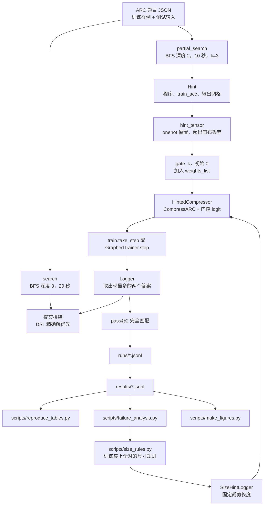
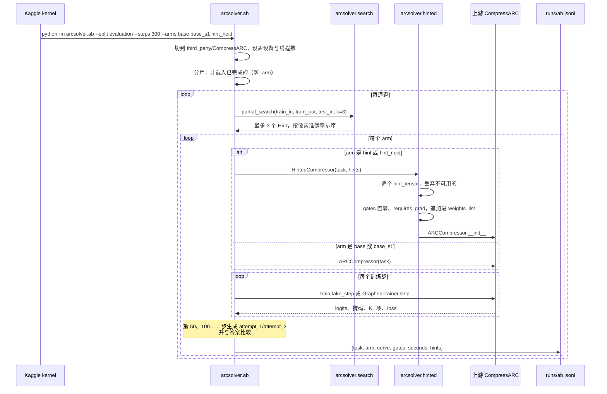
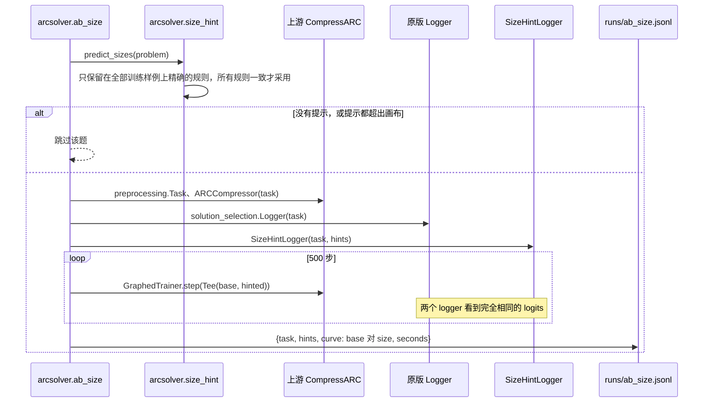
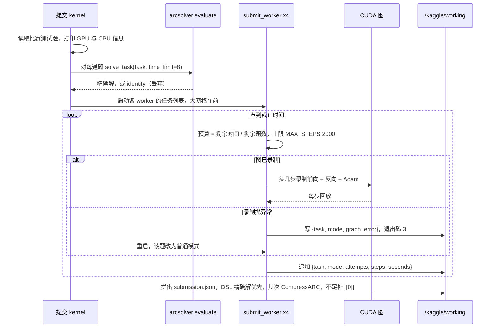
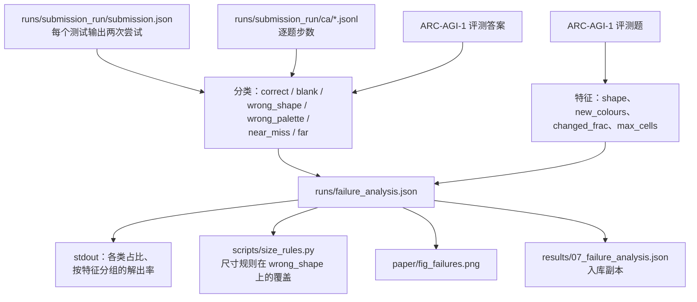
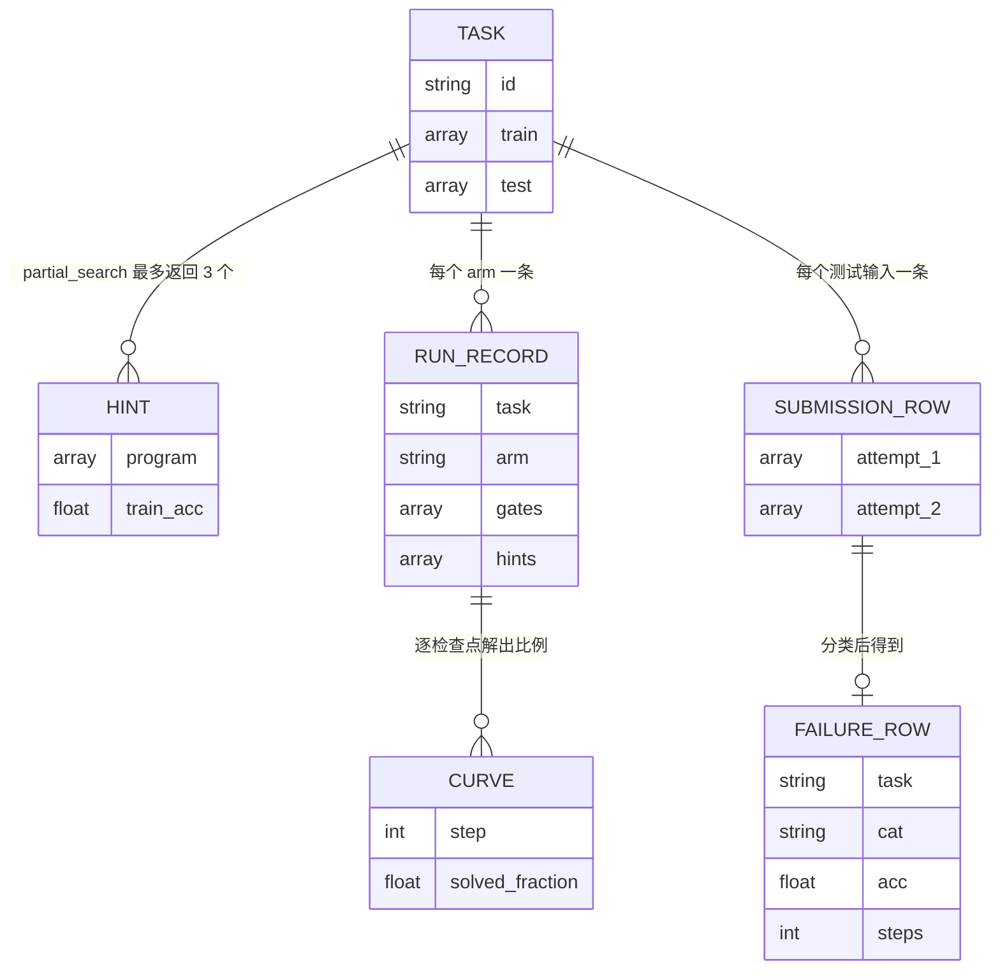
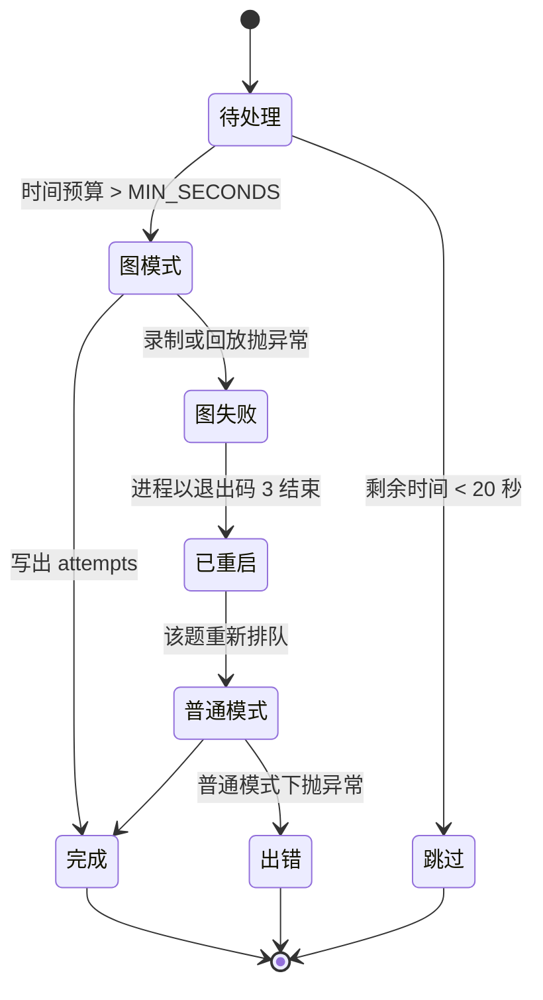

# CompressARC 的符号提示 —— ARC Prize 2026

[English](README.md) | [简体中文](README.zh-CN.md)

这是一个 ARC Prize 2026 Paper Track（ARC-AGI-2 赛道）参赛项目的研究代码、原始运行日志和论文草稿。
它要回答的问题是：廉价的符号程序搜索，能否给 CompressARC（不预训练、对每道题现场训练的小网络）
提供有用的先验知识？就这里试验过的形式而言，答案是没有可测量的提升：整图提示通道确实被模型用上了，
但解出的题数不比"换个随机种子"更多；只给输出尺寸的提示每次都算对，却一道题也没多解出。仓库同时还
包含两项不改变求解率的加速（CUDA 图训练步、向量化答案读出），以及从 `results/` 重算论文全部表格所需
的一切。

这是一个研究产物，不是可供依赖的库。仓库没有打包、没有版本号、也没有发布。

---

## 概览

ARC-AGI-2 是一组网格谜题：解题者看几个输入 / 输出样例，然后为新的输入给出输出。CompressARC
（Liao & Gu, 2025）用最小描述长度来对付它——对每道题从零训练一个极小的解码器，直到找到能解释
全部训练样例的最短程序。它在 ARC-AGI-1 上表现不错（评测集约 20%），在 ARC-AGI-2 上很弱（约 4%）。

本项目探索的是一种分工：先让符号 DSL 搜出一个**部分正确**的程序（训练样例上至少 50% 的格子对），
把它的输出作为输出 logit 上的加性偏置交给 CompressARC，每个提示配一个初始化为 0 的可学习门控。
提示有用，门控就长大；没用，就一直接近 0。由此展开三项受控研究：整图提示的 A/B（两轮）、
CompressARC 到底错在哪的失败分析，以及据此构造的、只改变答案读出方式的尺寸提示。

目标读者是三类人：想复现这些数字的人、想扩展提示通道的人、想复用 CUDA 图训练器的人。
`WORKLOG.md` 是按时间顺序的实验室笔记，`paper/` 是论文草稿，`results/` 是论文引用的全部日志。

先说两个前提：

- **仓库没有内置依赖。** `third_party/CompressARC`（上游解题器与数据集）和 `data_repo/`
  （ARC-AGI-2 数据）都在 `.gitignore` 里。几乎每个模块都要从该目录导入 `arc_compressor`、`train`、
  `layers` 或 `solution_selection`，所以刚 clone 下来什么也跑不了，必须先把 CompressARC 克隆进
  `third_party/`。
- **提示通道不在任何提交方案里。** 提交 worker 训练的是原版 `ARCCompressor`，提交结果是 DSL 精确解
  加未改动的 CompressARC（`arcsolver/submit_worker.py:38`）。提示是实验，不是参赛方案的组件。

---

## 目录

- [研究问题](#研究问题)
- [功能](#功能)
- [架构](#架构)
- [关键流程](#关键流程)
- [数据模型](#数据模型)
- [实验与结果](#实验与结果)
- [加速](#加速)
- [目录结构](#目录结构)
- [快速开始](#快速开始)
- [命令](#命令)
- [配置](#配置)
- [CLI 参考](#cli-参考)
- [Kaggle 打包](#kaggle-打包)
- [排错](#排错)
- [设计取舍与已知限制](#设计取舍与已知限制)
- [FAQ](#faq)
- [许可](#许可)

---

## 研究问题

CompressARC 的归纳偏置里已经包含了手写 DSL 能表达的大部分东西：旋转 / 翻转等变性、逐颜色通道、
信息传播层。因此 DSL 提示的价值，只取决于它带来了多少模型先验里没有的信息（`paper/draft.md` §5）。
仓库分三步检验这个判断：

1. **整图提示** —— 把部分正确程序的输出作为带门控的 logit 偏置注入，能否多解题、或更早解出？
   （在 ARC-AGI-1 评测题上做两轮。）
2. **失败分析** —— 未改动的解题器究竟错在哪？（对一次完整提交运行的 99 个测试输出分类。）
3. **尺寸提示** —— 如果诊断出的弱点是输出**尺寸**，只把这个尺寸告诉它，能解决什么吗？
   （配对 A/B：同一次训练，两种读出方式。）

第 1 步的判定标准在第二轮跑之前就已写好：提示版必须比原版多解出的题数，**超过**原版换一个随机种子
后与自己的差异（`WORKLOG.md`，"第二轮验证"）。

---

## 功能

**符号搜索**
- 46 个网格原语：几何变换 7 个、裁剪与物体选择 7 个、半网格切分 4 个、缩放 / 平铺 / 镜像 12 个、
  重力与填充 8 个、半网格逻辑运算 8 个（`arcsolver/dsl.py:273`）。
- 精确搜索：对原语的组合做深度 3 的 BFS，限时 20 秒，最多 8 个不同候选；若事后学到的颜色映射能让
  程序完全正确，也接受（`arcsolver/search.py:52`）。
- 用于提示的部分搜索：深度 2，限时 10 秒，输出尺寸必须与每个训练目标一致，像素准确率 ≥ 0.5，
  按准确率取前 3 个（`arcsolver/search.py:121`）。

**提示注入**
- 每个提示在非黑 logit 通道上加一项偏置 `gate_k · onehot(hint_k)`，`gate_k` 是标量，初始为 0，
  与模型权重一起训练（`arcsolver/hinted.py`）。
- 需要任务里没有的颜色、或网格超出任务画布的提示会被丢弃，而不是裁剪（`hinted.py:25-48`）。

**加速**
- `GraphedTrainer`：把前向 + 反向 + Adam 整步录进一张 CUDA 图后回放，并把两个随步数变化的
  热身系数改成设备张量（`arcsolver/fast.py`）。
- 向量化答案读出：一次前缀和取代每个候选窗口的三次 `torch.sum`，并保留原有的平局规则
  （`fast.py:51-76`）。

**实验与工具**
- A/B 运行器，含 `base`、`base_s1`（种子噪声对照）、`hint`、`hint_noid` 四种 arm，可分片、可续跑，
  每个（题, arm）写一行 JSON（`arcsolver/ab.py`）。
- 配对尺寸提示运行器：一次训练、两种方式读出（`arcsolver/ab_size.py`）。
- Kaggle 驱动脚本：CPU A/B、GPU A/B、复现、提交 kernel，以及带逐题时间预算、可续跑的提交 worker
  （`scripts/`、`arcsolver/submit_worker.py`）。
- `scripts/reproduce_tables.py`：不需要 GPU、不需要数据集，从 `results/` 重算论文里的每个数字。

---

## 架构



图中 `MODEL` / `STEP` / `READ` 三个阶段用的是上游类，不在本仓库里，而来自 `third_party/CompressARC`。

| 层 | 路径 | 职责 |
|---|---|---|
| 原语 | `arcsolver/dsl.py` | 46 个网格→网格函数，不适用时返回 `None`；物体与包围盒辅助函数 |
| 搜索 | `arcsolver/search.py` | 精确 BFS（`search`）、部分 BFS（`partial_search`）、颜色映射拟合 |
| 提示通道 | `arcsolver/hinted.py` | `hint_tensor`、继承上游压缩器的 `HintedCompressor` |
| 训练步 | `arcsolver/fast.py` | CUDA 图训练器、被替换的上游函数、向量化窗口打分 |
| 尺寸提示 | `arcsolver/size_hint.py` | 约 20 条尺寸规则、`predict_sizes`、`SizeHintLogger` |
| A/B 运行器 | `arcsolver/ab.py` | arm 定义、分片、每 50 步检查点、JSONL 落盘 |
| 配对运行器 | `arcsolver/ab_size.py` | 一个模型、两个 logger、逐检查点求解向量 |
| 提交 worker | `arcsolver/submit_worker.py` | 逐题时间预算、图失败回退、可续跑 JSONL |
| 本地基准 | `arcsolver/bench_fast.py` | 单题上 eager 与图模式的步耗时与 loss |
| 评测 | `arcsolver/evaluate.py` | 只用 DSL 的解题器，按官方两次尝试规则打分 |
| Kaggle 驱动 | `scripts/kaggle_*.py` | 构建数据集 / kernel、推送、轮询、拉取、提交 |
| 离线分析 | `scripts/reproduce_tables.py`、`scripts/failure_analysis.py`、`scripts/size_rules.py` | 表格、失败分类、尺寸规则覆盖 |
| 图表 | `scripts/make_figures.py` | `paper/fig_cover.png`、`fig_failures.png`、`fig_round2.png` |
| 上游 | `third_party/CompressARC/`（不入 git） | `arc_compressor`、`preprocessing`、`solution_selection`、`train`、`layers`、`dataset/` |

---

## 关键流程

### 1. 一次 A/B 实验（搜索 → 注入提示 → 训练 → 评估 → 落盘）

`arcsolver.ab` 从 CompressARC 的 dataset 目录读入题目与答案，对每道题只做一次部分搜索，然后让各
arm 在相同种子、相同步数下训练。每 50 步记录一次按两次尝试规则算出的测试输出解出比例；每个
（题, arm）立刻追加一行 JSON，所以中途被杀的运行也能拿回已完成的部分（`arcsolver/ab.py:36-105`）。



### 2. 配对尺寸提示（一次训练，两种读出）

尺寸提示只改变读答案时的裁剪长度，从不影响 loss。两个 arm 因此看到同样的采样与权重，比较中不存在
种子噪声（`arcsolver/ab_size.py`）。凡是所有预测尺寸都超出模型画布的题会被跳过。



### 3. 提交运行（DSL 精确解 → 4 个 worker → 拼装）

提交 kernel 只保留在每个训练样例上都精确的 DSL 程序，在一张 GPU 上起四个 worker 进程，按网格从大到小
排序，把剩余时间平均分给剩下的题。CUDA 图录制失败时 worker 以退出码 3 结束，父进程重启它，该题改用
普通模式重跑（`scripts/kaggle_submit_v3.py:35-134`、`arcsolver/submit_worker.py:58-94`）。



### 4. 失败分析路径

分析是一条对未入库产物的过滤链：拉回来的提交文件、逐题与逐 worker 日志、ARC-AGI-1 评测题文件。
每个测试输出按"第一条命中的规则"分类——完全正确、空答案、尺寸错、颜色错、差一点（≥90% 格子）、
差得多（`scripts/failure_analysis.py:28-43`）。



---

## 数据模型

没有数据库。真正的单位是文件：ARC 题目 JSON、内存里的 hint 与 candidate 对象、每次训练一行的 JSON、
拼装好的提交文件，以及每个被分类的测试输出一行记录。



**Task** —— `arc-agi_<split>_challenges.json` 里的一个对象，含 `train`（输入 / 输出对）与 `test`
（只有输入）。答案在另一个平行文件里；比赛的测试文件没有对应答案文件。

**Hint**（`arcsolver/search.py:107`）—— `program` 是原语名列表（`[]` 表示恒等程序），`train_acc`
是逐样例像素准确率的均值，且只有在程序输出尺寸与每个训练目标一致时才有定义；两个输出列表存放交给
`hint_tensor` 的网格。

**Run record** —— `arcsolver/ab.py` 写出的结构：

| 字段 | 类型 | 含义 |
|---|---|---|
| `task` | string | 题目 id |
| `arm` | string | `base`、`base_s1`、`hint`、`hint_noid` |
| `curve` | object | `{"50": 1.0, "100": 1.0, ...}` 各检查点的解出比例 |
| `gates` | number[] | 结束时每个提示的门控最大值；baseline arm 为空 |
| `seconds` | number | 该 arm 全部步数的墙钟时间 |
| `hints` | object[] | 搜索返回的每个提示的 `{program, train_acc}` |

**Submission** —— `{task_id: [{attempt_1, attempt_2}, ...]}`，每个测试输入一项；不足两个不同候选时
用 `[[0]]` 补齐（`kaggle_submit_v3.py:110-126`）。

**Failure row** —— 入库为 `results/07_failure_analysis.json`：95 道题共 99 行
（`task`、`i`、`cat`、`acc`、`steps`、`shape`、`new_colours`、`changed_frac`、`max_cells`）。

### Worker 的题目状态

提交 worker 的逐题状态机是"被杀也能续跑"的原因。重启时它重读自己的 JSONL，把记录了 `attempts` 的题
视为已完成；带 `graph_error` 的题改用普通模式重试（`submit_worker.py:66-68`）。



---

## 实验与结果

下表所有数字都抄自 `results/`，或抄自来源列注明的 `WORKLOG.md` 段落；`results/` 里的数字可以用
`python scripts/reproduce_tables.py` 重算。两轮提示实验都在 ARC-AGI-1 评测题上做，不是 ARC-AGI-2。

| # | 问题 | 操纵 | 题目与预算 | 结果 | 来源 |
|---|---|---|---|---|---|
| E1a | 整图提示能多解题吗？（探索性） | 把前 3 个部分正确程序的输出作为带门控的 logit 偏置，对比同种子的原版 | 40 道 ARC-AGI-1 评测题（网格最小且带非恒等提示），400 步，Kaggle T4，4 进程 | 8.5 对 8.5（逐题解出比例之和）；只有原版解出 2 题，只有提示版解出 2 题；35/40 的门控 > 0.5 | `results/03_hint_ab_round1.jsonl`、`paper/draft.md` §4.3 |
| E1b | 在没见过的题上重问一次，并加入种子噪声对照（事先登记） | 三个 arm：`base`、`base_s1`（种子 1）、`hint_noid`（去掉恒等提示） | 另外 40 道 ARC-AGI-1 评测题，300 步，同一硬件 | base 5、种子 1 基线 7、提示版 7；base 与种子 1 有 2 题结果不同，base 与提示版也有 2 题不同；33/40 的门控 > 0.5 | `results/04_hint_ab_round2.jsonl` |
| E2 | CompressARC 到底错在哪？ | 无操作（诊断）：对一次完整运行的每个测试输出分类 | v2 提交运行里 95 道 ARC-AGI-1 评测题 / 99 个输出 | 正确 20.2%、差一点 21.2%、差得多 27.3%、颜色错 18.2%、尺寸错 12.1%、空答案 1.0%；输出比输入小的题 0/11 解出，其中 9 个是尺寸错 | `results/07_failure_analysis.json` |
| E3 | 只给对的输出尺寸有帮助吗？ | 用"训练集上全对"的尺寸规则预测裁剪长度，对同一次运行换一种读出方式 | 规则会触发的 15 道题，500 步，本机 RTX 3060，完全配对 | 0 对 0；任何检查点上都没有题出现差别；预测尺寸 15/15 全对 | `results/05_size_hint_paired.jsonl`、`WORKLOG.md`（10-09、10-12） |

怎么读这张表：

- **E1 是零结果，仓库也照零结果写。** 事先定的规则是：提示版必须比原版多解出的题数超过原版换种子
  与自己的差异。第二轮里两个差异都是 2 题，规则不成立（`WORKLOG.md`，"第二轮验证"）。第一轮看到的
  交互——程序类提示靠前、恒等提示靠后（解出曲线下面积：首选提示是真实程序的 25 题 23.0 → 29.5，
  首选提示是 identity 的 15 题 19.0 → 12.0）——正是第二轮要检验的假设，但没有复现。
- **门控确实被用上了。** 第一轮门控最大值的单位数是 1.50，40 次提示运行里 35 次收在 0.5 以上；
  第二轮是 40 次里 33 次。模型在听提示，只是提示没带来它缺的信息。
- **E2 解释了 E3。** 最清楚的缺口是"输出变小"的题上的尺寸，而这恰好是符号规则能精确算出来的。
  E3 把这信息给了模型，尺寸每次都算对，解出数却纹丝不动——说明在这些题上，尺寸是必要条件但不是瓶颈。

可由 `python scripts/make_figures.py` 重新生成的入库图：

| 图 | 内容 |
|---|---|
| `paper/fig_round2.png` | 第二轮解出曲线；种子 1 与提示版从第 200 步起重合 |
| `paper/fig_failures.png` | 99 个输出的失败类别占比 |
| `paper/fig_cover.png` | Kaggle 写作用的封面：一道题、它的 `symmetrize` 提示、答案 |

排行榜口径（`paper/draft.md` §4.6）：只用 DSL 为 0.00%；v2、v4、v5（DSL 精确解 + CompressARC）在
隐藏的 ARC-AGI-2 上都是 1.67%，约等于 240 题里对 4 题。这几个版本之间的工程改动，对分数的推动不到
一道题。这是 Kaggle 比赛分数，不是经过同行评议的结果。

---

## 加速

CompressARC 是启动开销受限的：一个训练步要发约 7 万个小 kernel，GPU 大部分时间在等
（`fast.py:1-7`、`paper/draft.md` §3.4）。两项改动由此而来。

| 加速 | 实测 | 口径 | 数字出处 |
|---|---|---|---|
| CUDA 图训练步 | 3.62 → 0.97 秒/步（每进程），3.7× | Kaggle T4，4 进程共用一张卡，400 步 | `paper/draft.md` §4.2；eager 计时在 `results/03_hint_ab_round1.jsonl`，图模式计时在 `results/02_repro_cudagraph_t4.jsonl` |
| CUDA 图正确性 | 解出 7/8，与 eager 一致 | 作者能在 200 步内解出的 8 道 ARC-AGI-1 评测题，400 步 | `results/01_repro_eager_t4.jsonl`、`results/02_repro_cudagraph_t4.jsonl` |
| CUDA 图，本机 | 2.7–3.9 → 0.28–0.36 秒/步，8–12× | RTX 3060，Windows | `WORKLOG.md`（10-07） |
| 向量化读出，30×30 题 | 967 → 24 毫秒，39× | 只测读出，固定 logits，RTX 3060 | `WORKLOG.md`（10-22 表，题 `1f85a75f`） |
| 向量化读出，729 格题 | 746 → 22 毫秒，34× | 只测读出，题 `1190e5a7` | `WORKLOG.md`（10-22 表） |
| 向量化读出，同尺寸题 | 5.4 → 3.9 毫秒，1.4× | 题 `007bbfb7` | `WORKLOG.md`（10-22 表） |
| 30×30 题的整步 | 1521 → 521 毫秒/步 | 读出约占该步的 2/3 | `WORKLOG.md`（10-12） |
| 对整次提交的影响 | 等效约 +3.7% 速度，中位数 566 → 约 588 步 | 240 道公开题中的 13 道，占总时长 5.4% | `WORKLOG.md`（10-22） |

`reproduce_tables.py` 会从两个复现文件里打印它自己的中位数：eager 1.77 秒/步，CUDA 图 0.97 秒/步，
两者都是 7/8。eager 的 1.77 与上面的 3.62 不同，因为它来自另一个更小的题目集——论文也写明两个每进程
数字来自不同题目集，3.7× 只是近似值。没有做过同题、整卡的 eager 基线，因此不主张任何吞吐倍数
（`paper/draft.md` §4.2）。

图模式的做法，简单说：

- 重新编译 `layers.channel_layer`，去掉两处 `torch.tensor(float)` 转换——它们是主机到设备的拷贝，
  在录制期间不合法（`fast.py:20-33`）。
- `layers.postprocess_mask` 把任务常量只算一次并按题缓存，而不是每次前向都用 numpy 重建
  （`fast.py:38-48`）。
- 热身阶段复用同一条 side stream；每一步新建 stream 会让分配器缓存每次多出一整步的量
  （`fast.py:188-199`、`WORKLOG.md` 10-07）。
- `coefficients(step)` 把原来的 Python 浮点热身斜坡变成两个设备张量，在回放前填好，于是一张图能服务
  所有步（`fast.py:158-179`）。

等价性是验证过的，不是假设的：`tests/test_best_slice_point.py` 在 4000 个随机掩码（含大量平局与
全零情形）上对比向量化切片搜索与原版；`tests/test_loss_equivalence.py` 在四道含变尺寸输出的题上
对比整步 loss。

---

## 目录结构

```text
arc-prize-2026/
├─ README.md                  # 英文版
├─ README.zh-CN.md            # 本文件
├─ LICENSE                    # MIT No Attribution
├─ WORKLOG.md                 # 按时间顺序的实验室笔记，所有决策与数字
├─ .gitignore                 # 排除 third_party/、data_repo/、runs/、build/、.venv/
├─ arcsolver/
│  ├─ __init__.py             # 空文件
│  ├─ dsl.py                  # 46 个原语 + 物体/包围盒辅助
│  ├─ search.py               # 精确 BFS、partial_search、Hint、颜色映射
│  ├─ hinted.py               # hint_tensor、HintedCompressor、third_party 路径
│  ├─ fast.py                 # GraphedTrainer、被替换的上游函数、向量化读出
│  ├─ size_hint.py            # 尺寸规则、predict_sizes、SizeHintLogger
│  ├─ ab.py                   # 带种子对照的 A/B arm，JSONL 输出
│  ├─ ab_size.py              # 配对的原版 vs 尺寸提示读出
│  ├─ submit_worker.py        # 单个提交 worker，带墙钟预算
│  ├─ bench_fast.py           # 单题 eager 与图模式的毫秒/步与 loss
│  └─ evaluate.py             # 只用 DSL 的打分器，官方两次尝试规则
├─ scripts/
│  ├─ select_hint_tasks.py    # 挑出有非平凡、非精确提示的题
│  ├─ kaggle_ab.py            # CPU A/B kernel（第一轮），并共享数据集构建器
│  ├─ kaggle_ab_gpu.py        # GPU A/B kernel（第二轮）+ 图正确性检查
│  ├─ kaggle_repro.py         # 8 道题上复现未改动的 CompressARC
│  ├─ kaggle_submit.py        # v1/v2 提交 kernel
│  ├─ kaggle_submit_v3.py     # v3 kernel：向量化读出、DSL 精确解优先
│  ├─ failure_analysis.py     # 错答分类、结构特征
│  ├─ size_rules.py           # 尺寸规则对 CompressARC 尺寸错的覆盖
│  ├─ reproduce_tables.py     # 从 results/ 重算论文全部数字
│  └─ make_figures.py         # 三张论文配图
├─ tests/
│  ├─ test_best_slice_point.py   # 4000 个随机掩码，平局规则完全一致
│  ├─ test_fast_logprobs.py      # 前缀和打分器对比上游，三种掩码
│  └─ test_loss_equivalence.py   # 4 道真题上的整步 loss 等价
├─ results/                   # 论文引用的入库日志（00-07）
├─ paper/                     # draft.md、writeup_submit.md、中文讲解、配图
├─ third_party/CompressARC/   # 不入 git：上游解题器与数据集
├─ data_repo/                 # 不入 git：arcsolver.evaluate 用的 ARC-AGI-2 数据
├─ runs/                      # 不入 git：全部实验产物，从 Kaggle 拉回
└─ build/kaggle/              # 不入 git：生成的 kernel 与数据集目录
```

这三个缺失目录不是可有可无的装饰：`arcsolver/hinted.py:17` 把上游包解析为
`parents[1]/third_party/CompressARC`，每个训练模块都从那里导入。

---

## 快速开始

### 前置条件

| 需要 | 用于 | 说明 |
|---|---|---|
| Python 3 | 全部 | 仓库没有版本约束，也没有 `requirements.txt`；代码依赖 `from __future__ import annotations` |
| `numpy` | 全部 | 网格就是 `np.ndarray` |
| `torch` | 除纯 numpy 的搜索外的一切 | 训练和 `arcsolver.fast` 需要 CUDA 版本 |
| `matplotlib` | 仅 `scripts/make_figures.py` | 用 Agg 后端 |
| Kaggle CLI + API token | `scripts/kaggle_*.py` | 驱动脚本去 `.venv/Scripts/kaggle` 找二进制，并读 `~/.kaggle/` |
| CompressARC 源码与数据集 | 所有训练与评测 | 克隆进 `third_party/CompressARC`，其 `dataset/` 下要有 `arc-agi_*_challenges.json` 与 `_solutions.json` |

### 安装上游依赖

```bash
git clone https://github.com/Ethan-upgrade/arc-prize-2026.git
cd arc-prize-2026
git clone https://github.com/iliao2345/CompressARC.git third_party/CompressARC
python -m pip install numpy torch matplotlib kaggle
```

CompressARC 自带 `dataset/` 目录。`arcsolver.ab`、`ab_size`、`bench_fast`、`kaggle_repro`、
`failure_analysis`、`size_rules` 都从那里读 JSON；`arcsolver.evaluate` 则要求
`data_repo/data/evaluation/` 下每题一个 JSON 文件（可用 `--data` 覆盖）。

### 不需要 GPU 的冒烟测试

```bash
python scripts/reproduce_tables.py                 # 从 results/ 重算每个表格数字
python tests/test_best_slice_point.py              # CPU，需要上游包在路径上
```

### 本地跑一个 A/B arm

```bash
DEV=cuda python -m arcsolver.ab --split evaluation --steps 400 \
  --tasks 4cd1b7b2 bbb1b8b6 fc754716 --arms base hint --out runs/ab_local.jsonl
```

`arcsolver.ab` 的 `DEV` 默认是 `cpu`，CPU 也能跑但很慢：`WORKLOG.md` 记录 Kaggle CPU 约 5 秒/步，
T4 上四进程并行时每进程约 3.6 秒/步。

### 跑配对尺寸提示实验

```bash
DEV=cuda python -m arcsolver.ab_size --split evaluation --steps 500 --out runs/ab_size.jsonl
```

`ab_size` 默认 `DEV=cuda`，并且总是使用 `GraphedTrainer`，所以需要可用的 CUDA 设备。

---

## 命令

| 命令 | 作用 |
|---|---|
| `python -m arcsolver.evaluate --time-limit 15` | 在 `data_repo/data/evaluation` 上给纯 DSL 打分，写 `runs/latest.json` |
| `python scripts/select_hint_tasks.py --split evaluation --out runs/hint_tasks_agi1.json` | 把题分成 DSL 精确组与非平凡部分提示组，小网格在前 |
| `python -m arcsolver.ab --split evaluation --steps 400 --arms base hint` | 整图提示 A/B，每个（题, arm）一行 JSON |
| `python -m arcsolver.ab --steps 300 --arms base base_s1 hint_noid` | 第二轮设计，含种子噪声对照 |
| `DEV=cuda python -m arcsolver.ab_size --split evaluation --steps 500 --out runs/ab_size.jsonl` | 每题一次训练，配对比较原版与尺寸提示读出 |
| `python -m arcsolver.bench_fast <task> <steps>` | eager 与 CUDA 图模式的毫秒/步、尾部 loss、是否解出 |
| `python -m arcsolver.submit_worker <challenges> <ids_csv> <out.jsonl> <deadline>` | 单个提交 worker，按剩余题数平分时间 |
| `python scripts/kaggle_repro.py push\|status\|pull` | 在 8 道题上复现未改动的 CompressARC，结果进 `runs/repro/` |
| `python scripts/kaggle_ab.py push\|status\|pull` | 第一轮 CPU A/B：2 个 kernel × 4 个 worker，500 步，结果进 `runs/ab_kaggle/` |
| `python scripts/kaggle_ab_gpu.py push\|status\|pull` | 第二轮 GPU A/B，第 41–80 题，结果进 `runs/ab_gpu_r2/` |
| `python scripts/kaggle_ab_gpu.py fastcheck` / `fastcheck-pull` | 8 道复现题上的图正确性检查，结果进 `runs/fast_check/` |
| `python scripts/kaggle_submit.py push\|status\|pull\|submit <version> "<msg>"` | v1/v2 提交 kernel |
| `python scripts/kaggle_submit_v3.py dataset\|push\|status\|pull\|submit` | v3 提交 kernel（DSL 精确解优先、向量化读出） |
| `python scripts/failure_analysis.py` | 给拉回来的提交分类，写 `runs/failure_analysis.json` |
| `python scripts/size_rules.py` | 尺寸规则在 CompressARC 尺寸错输出上的覆盖（需要 `runs/failure_analysis.json`） |
| `python scripts/reproduce_tables.py` | 从 `results/` 重算 `paper/` 引用的每个数字 |
| `python scripts/make_figures.py` | 重新生成 `paper/fig_*.png`（封面需要上游数据集） |
| `python tests/test_best_slice_point.py` | 4000 个随机掩码，与原版切片搜索完全一致 |
| `python tests/test_fast_logprobs.py` | 前缀和打分器对比上游，逐元素、两条代码路径 |
| `python tests/test_loss_equivalence.py` | 4 道题上的整步 loss 等价，含变尺寸输出 |

`tests/` 下是普通脚本，`main()` 末尾用 `assert` 断言。`pytest` 会把它们当模块导入但收集不到任何
测试函数，所以请用 `python` 运行。

---

## 配置

全部通过环境变量与常量配置，没有配置文件。

| 名称 | 默认值 | 位置 | 含义 |
|---|---|---|---|
| `DEV` | `ab.py` 为 `cpu`；`ab_size.py`、`submit_worker.py`、`bench_fast.py` 为 `cuda` | `torch.set_default_device` | 训练使用的设备 |
| `THREADS` | `1` | `ab.py:27` | `torch.set_num_threads`；四进程共卡时每进程单线程 |
| `TOTAL_HOURS` | `11.0` | 提交 kernel 运行脚本 | 拼装前的墙钟预算；Kaggle 12 小时杀进程 |
| `N_PROCS` | `4` | 提交 kernel 运行脚本 | 共用一张 T4 的 worker 数 |
| `PYTORCH_CUDA_ALLOC_CONF` | `expandable_segments:True` | kernel 启动 worker 时设置 | 4 进程运行使用的分配器设置 |
| `MAX_STEPS` | `2000` | `submit_worker.py:29` | 单题步数上限 |
| `MIN_SECONDS` | `20` | `submit_worker.py:30` | 单题最小预算，低于此值 worker 停止 |
| `GRAPH_FAILED` | `3` | `submit_worker.py:31` | 通知父进程重启并用普通模式重试的退出码 |
| Adam `lr`、`betas` | `0.01`、`(0.5, 0.9)` | `ab.py:46`、`fast.py:168` | 与上游一致的优化器设置 |
| 热身系数 | `0.01^(1-step/100)`、`0.1^(1-step/100)` | `fast.py:158-160` | 上游的尺寸/聚合斜坡，改写成设备张量 |
| 图预热步数 | `3` | `fast.py:166` | 录制前在 side stream 上的 eager 步数 |
| 搜索深度/时限 | 精确 3 / 20 秒，部分 2 / 10 秒 | `search.py:52`、`search.py:121` | BFS 限制 |
| 提示数量/阈值 | `k=3`、`min_acc=0.5` | `search.py:121-123` | 训练样例像素准确率 ≥ 50% 的前 3 个程序 |
| Kernel slug | `arc2026-submission-v3` | `kaggle_submit_v3.py:33` | Kaggle kernel 标识；数据集 slug 由 `kaggle_ab.py:22` 定为 `arc2026-hint-ab-code` |

---

## CLI 参考

没有 HTTP API。可调用的入口是三个模块和若干 Kaggle 驱动脚本。

| 入口 | 参数 | 说明 |
|---|---|---|
| `python -m arcsolver.ab` | `--split`（默认 `agi2eval`）、`--tasks`、`--steps`（500）、`--k`（3）、`--arms`（`base hint`）、`--fast`、`--shard i/n`、`--out` | 所有驱动脚本都显式传 `--split evaluation`；默认 split 只用于手动运行 |
| `python -m arcsolver.ab_size` | `--split`（`evaluation`）、`--steps`（500）、`--out`（必填） | 训练步固定走 CUDA 图 |
| `python -m arcsolver.submit_worker` | 位置参数：`challenges.json`、`task_ids_csv`、`out.jsonl`、`deadline_epoch` | 每题写一行并立即 flush；图失败时退出码 3 |
| `python -m arcsolver.bench_fast` | 位置参数：题号、步数，可选逗号分隔的 `kinds` | 按 kind 打印毫秒/步、尾部 loss、是否解出 |
| `python -m arcsolver.evaluate` | `--data`、`--time-limit`（20）、`--workers`（16）、`--out` | 只用 DSL；候选不足两个时回退为原样输出输入 |

---

## Kaggle 打包

实验在 Kaggle 上跑，是因为本机 Windows GPU 每步大约慢 10 倍——WDDM 驱动的小 kernel 启动开销很高，
而一次前向约 7 万次调用（`WORKLOG.md` 排错表）。`scripts/` 里的驱动脚本构建两类 Kaggle 产物：

- **私有数据集**（slug `arc2026-hint-ab-code`）：包含 `arcsolver/*.py`、除 `bench_one.py` 之外的上游
  `*.py`、上游 `LICENSE`，以及 ARC-AGI-1 的题目与答案 JSON（`scripts/kaggle_ab.py:67-84`）。
  `kaggle_repro.py` 与 `kaggle_submit_v3.py` 复用这个构建器。
- **私有脚本 kernel**：按需打开 `enable_gpu`，`enable_internet: false`，挂载数据集与比赛
  （`kaggle_ab.py:87-99`、`kaggle_submit_v3.py:138-149`）。

三类驱动共用 `push` / `status` / `pull`，比赛另有 `submit`。无论结果是从 `kaggle kernels output`
取回还是本地直接跑，形态都一样：JSONL，每题或每个（题, arm）一行，追加并 flush。

提交 kernel 只认比赛提供的测试题，绝不用代码数据集里碰巧存在的副本——这是个真实的坑（v2 早期会 glob
到 CompressARC 自带的 ARC-AGI-1 测试文件），现在改成了断言（`kaggle_submit.py:73-76`）。

---

## 排错

| 现象 | 原因 | 处理 |
|---|---|---|
| `ModuleNotFoundError: arc_compressor` | `third_party/CompressARC` 被 gitignore，不存在 | 把 CompressARC 克隆到 `third_party/CompressARC` |
| `FileNotFoundError: dataset/arc-agi_evaluation_challenges.json` | 上游克隆里没有 `dataset/` 文件，或工作目录不对 | 在仓库根目录运行；模块自己会 `chdir` 到 `third_party/CompressARC` |
| `arcsolver/evaluate.py` 报 FileNotFoundError | `data_repo/data/evaluation/*.json` 不入库且不存在 | 用 `--data` 指向一个每题一个 JSON 的目录 |
| `scripts/failure_analysis.py` 找不到 `runs/submission_run/submission.json` | 运行产物不入库 | 先 `python scripts/kaggle_submit.py pull`，或复现 v2 运行 |
| `scripts/size_rules.py` 找不到 `runs/failure_analysis.json` | 它读的是分析产物，不是 `results/` | 先跑 `failure_analysis.py` |
| `pytest` 报告没有测试 | 三个文件是脚本，`assert` 写在 `main()` 里 | 用 `python tests/<file>.py` 运行 |
| CUDA 图录制失败，worker 退出码 3 | 某步不适合录制，或热身时 OOM | 父进程会重启并用普通模式重试该题；kernel 会统计重启次数 |
| 热身时 CUDA OOM | 以前每个热身步新建 stream，各自分配缓存 | 已改为复用一条 side stream；最大题稳定在 2.65 GB（`WORKLOG.md` 10-07） |
| 训练比文档里慢约 10 倍 | 本机 Windows GPU（WDDM）启动开销 | 放到 Kaggle（T4）上跑 |
| `Kaggle CLI is not authenticated` | `kaggle config view` 读不到用户名 | 在 `~/.kaggle/` 放 token；二进制路径写死为 `.venv/Scripts/kaggle` |
| 数据集上传 409/403 | slug 与已有数据集冲突 | 改 `scripts/kaggle_ab.py:22` 里的 `DATASET_SLUG` |
| 提交被拒 403 | Kaggle 要求身份验证，与手机验证是两回事 | 在账号上完成身份验证 |
| 预览跑成了 11 小时而不是 `--hours` 指定的时长 | 以前 `build()` 被调用三次，把 env 前缀冲掉了 | 已修：`build()` 只跑一次并复用目录（`kaggle_submit_v3.py:165`） |
| 端到端测出来只有 1.10× | 测试时两个进程抢 CPU，把训练部分也拖慢了 | 不要引用这个数；只测读出的是 34–40×（`WORKLOG.md` 10-22） |

---

## 设计取舍与已知限制

**主结果是负结果，仓库照实写。**
- 整图提示在 80 道 ARC-AGI-1 题上没有带来超出种子噪声的解出数变化；一个 15/15 全对的尺寸提示也没有
  多解出任何题。论文的贡献是解释，不是更高的分数。
- 每轮只有 40 道题，每个 arm 每个种子只跑一次。判定标准是事先登记的，第二轮用的是没见过的题，但
  统计功效天生有限；仓库主张的是"没有观察到效果"，不是"任何形式的提示都没用"。
- 第一轮按提示类型的分组（真实程序 vs 恒等）记在 `WORKLOG.md` 里，但第二轮没有复现。

**提示通道不在提交方案里。**
- `submit_worker.py` 实例化的是原版 `arc_compressor.ARCCompressor`；提交内容是 DSL 精确解加未改动的
  CompressARC。门控提示纯属实验。
- 门控与权重一起被同一个 Adam 更新，本身没有复杂度惩罚——"没用时几乎零成本"说的是行为，不是 KL 项。

**数字的口径都很窄。**
- 3.7× 是 T4 上四进程时每进程的数字，且 eager 与图模式两组数字来自不同题目集；没有同题、整卡的基线
  （`paper/draft.md` §4.2）。
- 读出加速在大尺寸变长网格上是 34–40×，在小尺寸同尺寸题上是 1.4×；折算到那些大题的每一步约 3×，
  折算到 240 题整次运行约 3.7% 的墙钟时间。
- 失败分析用的是 Kaggle 公开测试文件中与 ARC-AGI-1 评测集重叠的部分（95 道题、99 个输出），不是
  ARC-AGI-2。
- 1.67% 的排行榜分数约等于 240 题里对 4 题；v2、v4、v5 之间的差别不到一道题。

**工程约束。**
- 没有 `requirements.txt`、没有锁定版本、没有 CI、没有打包。代码是在工作树里和 Kaggle kernel 上跑的。
- `third_party/CompressARC`、`data_repo/`、`runs/`、`build/` 都不入库，所以复现路径是"先克隆上游，
  再跑"，而不是"克隆即可跑"。
- `WORKLOG.md` 提到的 v4/v5 驱动脚本（`push_v4.py`、`queue_v5.py`）不在仓库里；
  `scripts/kaggle_submit_v3.py` 是最后一个入库的提交驱动。
- 搜索是单线程 BFS 加手写剪枝：提示深度 2、限时 10 秒。46 个原语两步组合表达不了的东西，这个方法
  看不见。
- 需要新颜色或超出画布的提示会被丢弃而不是裁剪（`hinted.py:36-48`），这让提示集偏向小尺寸、
  不改调色板的题。

---

## FAQ

**提示有用吗？** 没有可测量的提升。在 80 道 ARC-AGI-1 题上，提示版与原版的差异在种子噪声范围内
（2 题，和原版自己换种子的差异一样大）；尺寸提示在 15 道配对题上是 0 对 0。门控确实被用上了——
两轮分别是 35/40 和 33/40 超过 0.5——说明通道是通的，只是信息冗余。

**为什么刚 clone 下来什么都导入不了？** 因为 `third_party/` 不入库。`arcsolver/hinted.py` 把
`third_party/CompressARC` 加进 `sys.path`，每个训练模块都从那里导入。先克隆上游到该目录。

**提示能用到排行榜上吗？** 技术上可以接进去，但提交路径里没有用它，实验也没有给出应当使用的理由。

**为什么一张卡上开四个进程？** 因为瓶颈是启动开销而不是算力：单题显存只用 0.04–0.45 GB，而 T4 有
15 GB，所以在 CPU 核用完之前，多道题可以共用一张卡（`WORKLOG.md` 复现一节）。

**CUDA 图是换了个算法吗？** 不是。它回放的是同一套前向、反向和 Adam 更新；代码上只是去掉了两处
主机到设备的拷贝、缓存了一个任务常量掩码、把热身系数搬到设备张量。正确性由"同样 8 道题都解出 7 道"
和 loss 等价测试共同保证。

**"尺寸提示"具体是什么？** 就是读答案时固定裁剪长度。规则必须能复现每个训练输出的尺寸才会被接受，
所有被接受的规则在测试输入上一致时才采用（`arcsolver/size_hint.py:71-100`）。训练完全不动。

**怎么复现表格里的数字？** `python scripts/reproduce_tables.py`。它只读 `results/`，不需要 GPU、
不需要数据集，会打印复现、提示两轮、尺寸提示、提交和失败分析各节。

**经过同行评议或被接收了吗？** 没有。这是 Kaggle Paper Track 的投稿与 `paper/` 下自发布的草稿，
没有经过任何评审或接收。

---

## 许可

仓库以 MIT No Attribution 许可发布（`LICENSE`），版权人写在该文件里。

它建立在 CompressARC（MIT）之上，而后者**没有**被内置：`third_party/CompressARC` 不入库，克隆它时
你拿到的是它自己的许可与声明，这些继续适用。`scripts/kaggle_ab.py` 构建 Kaggle 数据集时会把上游
`LICENSE` 一起拷进去，原因正是如此。比赛的开源要求记在 `WORKLOG.md` §1（Kaggle 规则 CC-BY 4.0；
ARC 官网建议 CC0/MIT-0）。
