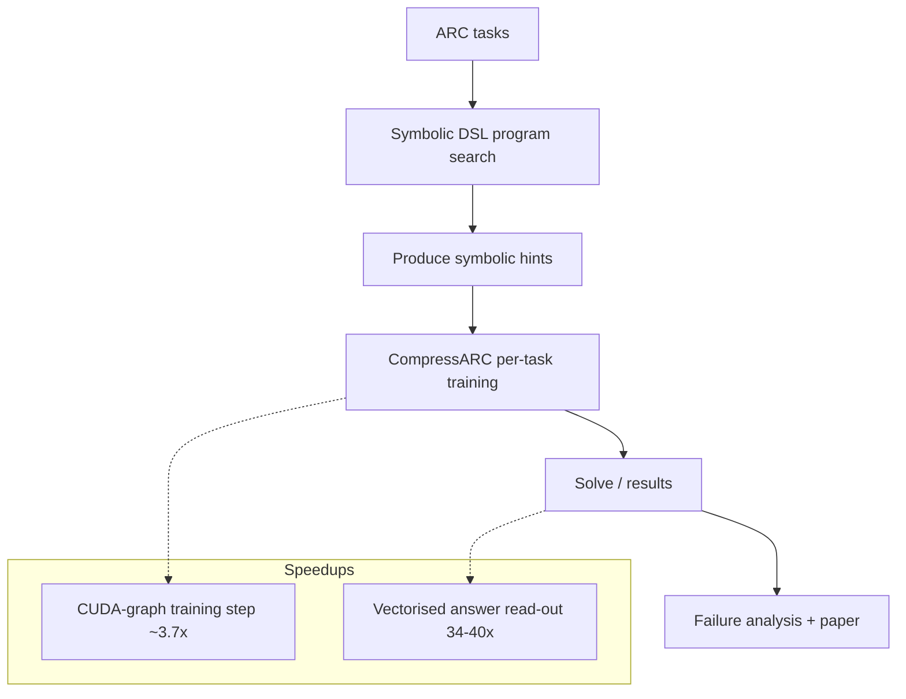

# Symbolic hints for CompressARC (ARC Prize 2026)

Code, raw results and a paper draft for an **ARC Prize 2026 Paper Track (ARC-AGI-2)** entry. Research question: can **cheap symbolic program search** give CompressARC (a per-task trained small network with no pretraining) useful priors? Across three controlled experiments the answer, in the forms we tried, is **no measurable gain**; two **solve-rate-preserving speedups** are also included.

## Highlights
- `arcsolver/`: symbolic DSL search and hint injection into CompressARC
- Three controlled experiments: (1) outputs of best partially-correct DSL programs as gated logit biases; (2) output-size priors; (3) failure analysis
- Two speedups: **CUDA-graph training step** (~**3.7x** on a Kaggle T4, 4 processes/card); **vectorised answer read-out** (read-out **34-40x** faster on large variable-size grids)
- `paper/` draft, `results/` raw results, `scripts/` repro, `tests/`, `WORKLOG.md`

## Architecture & Workflow


## Project Structure
```
arc-prize-2026/
├─ arcsolver/    # symbolic solver + hint injection
├─ paper/        # paper draft
├─ results/      # raw results
├─ scripts/      # reproduction scripts
├─ tests/
├─ WORKLOG.md
└─ README.md / README_EN.md
```

## Getting Started
```
git clone https://github.com/Ethan-upgrade/arc-prize-2026.git
cd arc-prize-2026
python -m pip install -r requirements.txt   # if present
# see scripts/ and WORKLOG.md to reproduce experiments
```

> This repository is derived from / builds on [iliao2345/CompressARC](https://github.com/iliao2345/CompressARC); its license and notices are retained.

## License
See `LICENSE`.