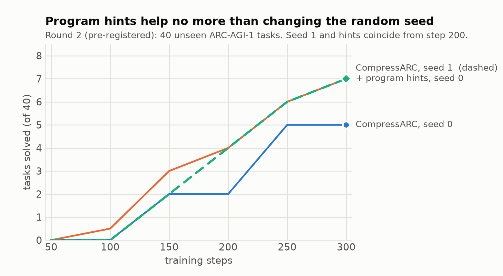
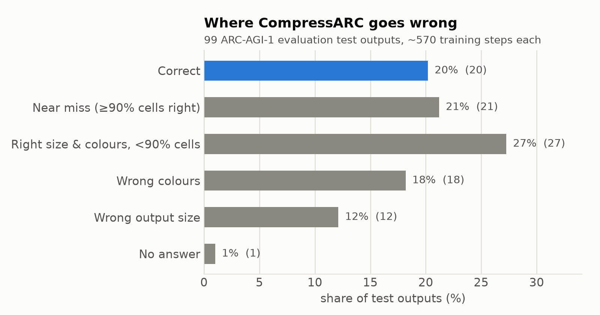

# Symbolic hints for a compression-based ARC solver: useful only where the prior is missing

**Subtitle:** Symbolic hints for CompressARC: what helps and what doesn't
**Track:** ARC-AGI-2
**Code:** https://github.com/Ethan-upgrade/arc-prize-2026
**Public notebook:** https://www.kaggle.com/code/chengjuncai/arc-2026-reproduce-tables

## Abstract

CompressARC solves ARC tasks with no pretraining by training a tiny network per task to compress it. We ask whether cheap symbolic program search can give it useful prior knowledge. We add learnable, zero-initialised gates that let it use the outputs of partially-correct DSL programs as logit hints. In two pre-registered A/B tests on 80 ARC-AGI-1 tasks, these whole-answer hints did not help: the gain equalled seed noise. A failure analysis explains why: the DSL proposes what CompressARC already finds alone, while its real weakness is elsewhere, most clearly output size (0/11 on shrinking tasks). A size-only hint was right on every task it fired on (18/18) yet solved none: size is necessary but far from sufficient. We also make CompressARC 3.7× faster per process on a Kaggle T4 with CUDA graphs, which fits a 240-task run into the 12-hour limit; our ARC-AGI-2 submission scores 1.67%.

---

## 1. Introduction

ARC-AGI measures skill acquisition from a few examples; ARC-AGI-2 is unsolved (best 2025 Kaggle score: 24.03%). Two families compete: program search (precise, brittle) and learned models (flexible, data-hungry). CompressARC (Liao & Gu, 2025) is unusual: it learns per task from scratch, with no pretraining, by minimising description length. Natural question: can the two be combined cheaply, by letting search tell the learner what it found?

Contributions:

1. A gated hint channel that lets CompressARC use symbolic program outputs at near-zero cost when they are useless.
2. A careful negative result, with seed-noise controls and a pre-registered decision rule.
3. A failure analysis showing which information the learner lacks, and a size-only hint built from it.
4. An engineering result: CUDA-graph training, 3.7× per process on a T4, that makes a 240-task run fit the 12-hour limit.

## 2. Prior work

- **CompressARC** (Liao & Gu, 2025, Paper Award 3rd): MDL, a per-task 76K-parameter decoder, ~20% ARC-AGI-1 eval, ~4% ARC-AGI-2. Used unmodified as the learner.
- **DSL program search** (Icecuber 2020; many since): exhaustive search over hand-written primitives; strong on ARC-AGI-1, near zero on ARC-AGI-2.
- **Hybrid / neuro-symbolic** (SOAR, Pourcel et al. 2025; Das et al. 2025): typically use an LLM to write programs. We go the other way: programs inform a tiny learner, with no LLM and no pretraining.
- **Test-time training** (ARChitects, NVARC): pretrained LLMs adapted per task; far larger compute.

## 3. Method

### 3.1 Partial program search

46 grid primitives (geometry, cropping, object selection, scaling, gravity, fills, half-grid logic), composed up to depth 2 with BFS. Unlike usual DSL solvers we keep programs that are partially right: output shape matches every training target and pixel accuracy ≥ 50%. A learned colour remap is applied when it makes a program exact. Top-3 by accuracy become hints.

### 3.2 Gated hint channel

For hint *k* with output grids *H_k*, we add `g_k · onehot(H_k)` to CompressARC's output logits, where `g_k` is a learnable scalar initialised at 0. In MDL terms the model now encodes the residual between hint and target; a useless hint leaves `g_k ≈ 0` and costs almost nothing.

### 3.3 Size-only hint

~20 rules map an input grid to an output size (bounding box of the largest object, cells between separator lines, ...). A rule is kept only if it is exact on every training pair; a test size is used only if all kept rules agree. The hint changes only how the answer is decoded (the crop length), not training, so one training run can be decoded with and without it: a perfectly paired comparison.

### 3.4 CUDA-graph training

CompressARC issues ~70k tiny kernels per step; on Kaggle GPUs it is launch-bound (<3% of VRAM used). We capture forward + backward + Adam into one CUDA graph and replay it, patching two capture blockers (a per-call scalar tensor, a per-step host-to-device mask copy) at import time. Reusing one side stream during warm-up was essential.

### 3.5 Vectorised answer read-out

When the output size is unknown, the answer is read out by scoring every (length, offset) window; the original calls `torch.sum` three times per window (~110k tiny kernels per step). One cumulative sum gives every window's score, with the original tie-breaking preserved exactly (4000 random masks, 0 mismatches). Read-out drops from 967 to 24 ms on a 30×30 task (39×) and from 746 to 22 ms on a 27×27 one (34×). It is ~2/3 of the step there, so the step gets ~3× cheaper; it is neutral on same-size tasks. Only 13 of 240 public tasks are of this kind, so the whole-run effect is ~3.7% of wall clock. It is a fairness fix, not a scoring one: those tasks previously received a median of 237 steps against 637 for the rest.

## 4. Results

### 4.1 Reproduction

Unmodified CompressARC, 8 ARC-AGI-1 eval tasks the authors solved within 200 steps: 7/8 solved within 400 steps on a T4 (same 7/8 with CUDA graphs).

### 4.2 Speed

| Config | eager | CUDA graph |
|---|---|---|
| Kaggle T4, per process, 4 processes | 3.62 s/step | 0.97 s/step (3.7×) |
| Correctness, same 8 tasks | 7/8 | 7/8 |
| Read-out only, 30×30 task (RTX 3060) | 967 ms | 24 ms (39×) |

The two per-process figures come from different task sets (eager: 40 round-1 A/B tasks; graph: the 8 reproduction tasks), so 3.7× is approximate. We did not run a like-for-like whole-GPU eager baseline and therefore claim no throughput multiplier.

### 4.3 Whole-answer hints (negative)

| Round | Tasks | Base (seed 0) | Base (seed 1) | Hinted |
|---|---|---|---|---|
| 1 (exploratory) | 40 | 8.5 | — | 8.5 |
| 2 (pre-registered) | 40 | 5 | 7 | 7 |

The gates were used (gate > 0.5 in 35/40 tasks in round 1 and 33/40 in round 2), but the solve rate did not change beyond seed noise.

### 4.4 Failure analysis

On 99 ARC-AGI-1 eval outputs from our full run: correct 20% · near-miss (≥90% of cells right) 21% · far 27% · wrong palette 18% · wrong shape 12% · blank 1%. Tasks whose output is smaller than the input: 0/11 solved. In near-misses, 72% of wrong cells are cells the model left unchanged that should have changed. On the 100 public tasks our final version reaches 20.2% (ARC-AGI-1 eval subset, pass@2), the same 20.2% as v2 and the published CompressARC.

### 4.5 Size-only hint

Rules fire on 18 ARC-AGI-1 eval outputs and are right on 18/18. Paired A/B (one run per task, decoded with and without the hint, 500 steps, 15 tasks): 0-to-0 solved, no difference at any checkpoint; the predicted size was right on all 15.

### 4.6 Leaderboard (ARC-AGI-2, private hidden set)

| Version | Score |
|---|---|
| DSL only | 0.00% |
| v2: DSL exact + CUDA-graph CompressARC | 1.67% |
| v4: vectorised read-out, DSL answers first | 1.67% |
| v5 (final): prefix-sum window scorer | 1.67% |

All three CompressARC versions score 1.67% (~4 of 240 tasks), so the engineering changes moved the score by less than one task. The final entry is v5, submission 57670191, code at commit ddcf7c9.

## 5. Why whole-answer hints fail

CompressARC's architecture already builds in the symmetries and operations a DSL hint would supply: equivariance to rotations and reflections, cumulative-max and shift layers for propagation, and per-colour channels. A DSL program that is ≥50% right on training pairs is almost always made of those same operations. Its output therefore lies close to a point the learner reaches on its own early in training, and the hint saves at most a few steps. Under MDL this is expected: a hint lowers description length only by the information it contains that the model's prior lacks.

The failure analysis points to where that missing information is. Output size is a global, discrete quantity. CompressARC can only express it through soft masks, and searches over it at decode time. Symbolic rules get it exactly right when they fire. Prediction: hints help in proportion to how far their content is from the learner's inductive bias. The size-only experiment gave a sharper answer: on tasks whose output shrinks, size is not the bottleneck. With the size fixed correctly, CompressARC still fails on content. Its weakness on these tasks is selection: deciding which part of the input to keep. A crop length cannot express that.

## 6. Conclusion

Cheap symbolic search is not a free lunch for a compression-based learner. Its usefulness depends on whether it tells the learner something new. We release code, all experiment logs and a CUDA-graph CompressARC that is 3.7× faster per process on Kaggle hardware.

---
